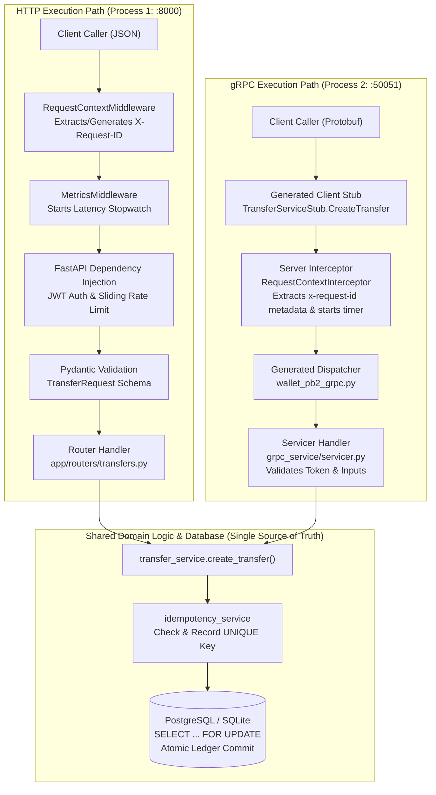
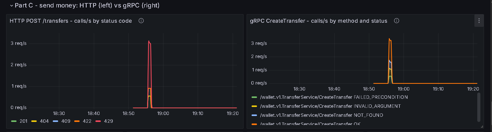
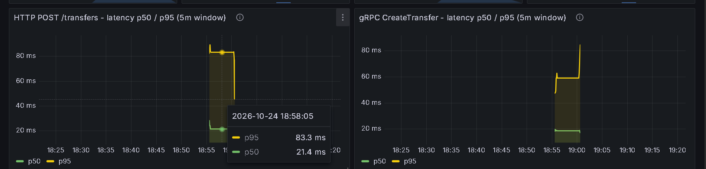
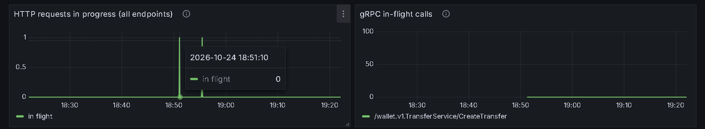
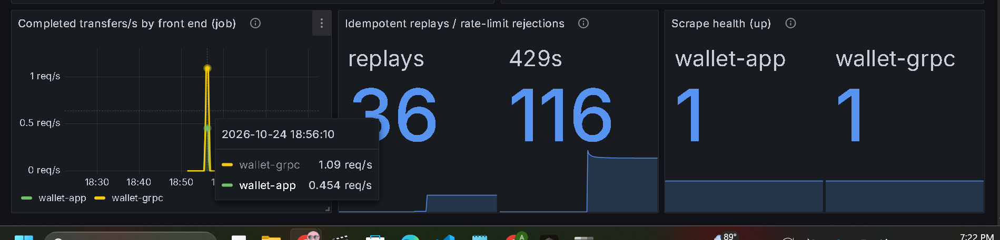

# Assignment 2: HTTP APIs, gRPC, and Metrics — Comprehensive Report

**Enterprise Software Development (Fall 2026)**  
**Student:** Muhammad Anas Akhtar  
**Repository:** [https://github.com/aanasakhtar/wallet-app](https://github.com/aanasakhtar/wallet-app)  
**Branch:** `assignment-2`  

---

## Executive Summary & Rubric Mapping

This report documents the architectural extension of the **Wallet App** from Assignment 1. The service evolves from a standalone REST API into a robust, polyglot enterprise financial system featuring a modernized HTTP/1.1 REST interface, a high-performance HTTP/2 gRPC microservice, resilient distributed client calling patterns, and comprehensive cross-protocol Prometheus and Grafana observability.

| Assignment Part | Topic | Key Deliverables & Implementation Highlights | Marks |
| :--- | :--- | :--- | :---: |
| **Part A: Improve HTTP API** | REST, OpenAPI, Idempotency, Rate Limiting, Resilient Caller | • Six REST constraints analyzed with concrete codebase mappings<br>• Formal OpenAPI 3.1 specification (`openapi/wallet-api.yaml`) with 25 contract tests<br>• Universal error envelope (`app/errors.py`) and standard REST status codes<br>• Chosen User Task: `POST /transfers` with `201 Created` + `Location` header<br>• Atomic `Idempotency-Key` header with database transaction rollback safety<br>• In-memory sliding-window rate limiter returning `429 Too Many Requests` + `Retry-After`<br>• Resilient client (`clients/resilient_client.py`) with timeout, exponential backoff, and circuit breaker | **40** |
| **Part B: Add gRPC Service** | Protobuf, RPC Handler, Dual Front-ends, Trace Correlation | • Unary RPC contract in `proto/wallet/v1/wallet.proto` compiled via `protoc`<br>• Dedicated gRPC daemon (`grpc_service/server.py`) running on port `50051`<br>• Shared business logic and database source of truth (`transfer_service.py`), NOT a wrapper<br>• Full protocol parity (success, business failures, idempotent replay)<br>• HTTP-to-gRPC status mapping table with `x-error-code` trailing metadata<br>• Distributed trace correlation across RPC boundary via `x-request-id` metadata | **30** |
| **Part C: Extend Metrics** | Metric Audit, gRPC Instrumentation, Side-by-Side Dashboard | • Systematic audit of A1 metrics: fixed multi-process DB gauge divergence via `DatabaseStateCollector`<br>• Metric Gap Table identifying missing signals across protocols<br>• Dedicated gRPC metrics (`handled_total`, `handling_seconds`, `in_flight`) on port `8002`<br>• Bounded label cardinality guarantees (zero user/request IDs in labels)<br>• Unified Grafana dashboard with side-by-side HTTP vs gRPC comparison panels<br>• Empirical traffic evaluation with real 30-round run, PromQL queries, and live dashboard evidence | **30** |
| **Total** | | | **100** |

All implementations are accompanied by automated tests: **7 suites across 185 checks passing 100%** (`python scripts/run_tests.py`).

---

# Part A: Modernizing the HTTP API

## A.1 The Six REST Architectural Constraints

The HTTP API was audited and updated against the six Roy Fielding REST architectural constraints:

| Constraint | Plain-Language Meaning | Demonstration in This API |
| :--- | :--- | :--- |
| **Client–Server** | Separation of user interface and data storage concerns. Client and server evolve independently through a well-defined contract. | **Demonstrated.** The Python clients (`clients/grpc_client.py`, `clients/resilient_client.py`) know nothing about SQLAlchemy ORM, SQLite/PostgreSQL internals, or process state. Communication occurs strictly via HTTP/JSON or HTTP/2/Protobuf payloads. |
| **Stateless** | Each request from client to server must contain all of the information necessary to understand and complete the request. No session context is stored on the server. | **Demonstrated.** Every authenticated request carries an `Authorization: Bearer <JWT>` header. The server re-validates the token cryptographically on every request without maintaining server-side user session tables. (Idempotency keys are request-level transaction receipts, not login sessions). |
| **Cacheable** | Responses must explicitly or implicitly define themselves as cacheable or non-cacheable to prevent clients from reusing stale data. | **Not Demonstrated (By Design).** Wallet balances and transfer ledgers represent real-time financial state that mutates on every debit/credit. Responses carry no permissive `Cache-Control` headers, and caching is prohibited to ensure strict transactional freshness. |
| **Uniform Interface** | A consistent, standardized contract across all endpoints: resource-based identification via URIs, resource manipulation through representations, self-descriptive messages, and hypermedia. | **Demonstrated.** Resources are identified with plural nouns (`/transfers`, `/wallet/topups`, `/transactions`). Standard HTTP methods (`GET`, `POST`) define semantics. All errors share a single unified JSON envelope (`app/errors.py`). Successful creation returns `201 Created` with a `Location: /transfers/{id}` hypermedia link. |
| **Layered System** | A client cannot ordinarily tell whether it is connected directly to the end server or to an intermediary along the way (proxies, gateways, load balancers). | **Demonstrated (Architecturally).** Because requests are completely stateless and authentication is token-based, reverse proxies (e.g. Nginx, Envoy, AWS ALB) can be placed in front of Uvicorn for SSL termination or load balancing without application-level modifications. |
| **Code on Demand** *(Optional)* | Servers may temporarily extend or customize client functionality by transferring executable code (e.g., scripts). | **Not Demonstrated.** As per the specification, this optional constraint is omitted; the server delivers pure data representations (JSON and Protobuf), not executable code. |

---

## A.2 OpenAPI 3.1 Specification & Contract Testing

### 1. Purpose of OpenAPI
The **OpenAPI Specification (OAS)** is a machine-readable, language-agnostic interface description standard for HTTP APIs. It provides a formal contract defining paths, parameters, request payloads, response bodies, and error schemas. This single source of truth powers automated documentation (Swagger UI/ReDoc), automated SDK and client stub generation, mock testing servers, and strict contract verification between frontend and backend teams.

### 2. Specification for this API
The OpenAPI 3.1 specification is located at [`openapi/wallet-api.yaml`](../openapi/wallet-api.yaml) (covering 11 distinct paths). It is generated directly from the codebase via [`scripts/export_openapi.py`](../scripts/export_openapi.py), eliminating documentation drift. 

To ensure the spec accurately reflects production behavior, two default FastAPI behaviors were explicitly overridden in [`app/openapi.py`](../app/openapi.py):
1. **Schema Standardization:** FastAPI defaults to documenting 422 validation errors using its internal `HTTPValidationError` structure. We replaced this with our uniform enterprise `ErrorResponse` envelope.
2. **Deterministic Operation IDs:** Overrode verbose generated operation IDs (e.g., `create_transfer_transfers_post`) with clean, readable identifiers (`create_transfer`, `get_transfer`).

### 3. Automated Inspection & Contract Validation
The specification is continuously verified by [`test_openapi.py`](../test_openapi.py) (25 automated assertions):
- **Schema Validation:** The exported YAML is validated against the official OpenAPI 3.1 JSON meta-schema using `openapi-spec-validator`.
- **Route Parity:** Asserts that every router method registered in FastAPI is documented in `wallet-api.yaml` with zero drift.
- **Payload Contract Tests (`POST /transfers`):** Real HTTP responses generated during valid requests (`201`), balance conflicts (`409`), missing parameters (`422`), missing tokens (`401`), and throttled calls (`429`) are validated against the declared JSON Schemas using `jsonschema.validate()`. Every status code returned by the running application is verified to exist in the OpenAPI document.

Interactive Swagger UI documentation is served live at `http://localhost:8000/docs`.

---

## A.3 Endpoint Review & Standardization

Every application endpoint was audited to enforce RESTful resource paths, correct HTTP verbs, strict payload validation, and standard status codes.

### Unified Error Format
In Assignment 1, error responses were fragmented: FastAPI validation errors returned `{ "detail": [...] }`, business exceptions returned `{ "detail": "message" }`, and database conflicts could surface as raw 500 stack traces. In Assignment 2, **all endpoints share a single error envelope** defined in [`app/errors.py`](../app/errors.py):

```json
{
  "error": {
    "code": "insufficient_balance",
    "message": "Insufficient balance",
    "request_id": "02ce78aa-9195-46eb-a9e9-bb84eb3ba645",
    "details": null
  }
}
```
The `request_id` matches the `X-Request-ID` response header and the server's structured JSON log lines, enabling immediate incident correlation.

### Endpoint Audit Table

| Endpoint | Method | Status | Verdict | Changes & Rationale |
| :--- | :---: | :---: | :---: | :--- |
| `POST /auth/signup` | POST | `201` / `409` | **Changed** | **Bug Fixed:** Duplicate phone previously crashed with unhandled 500 (unique constraint violation); now returns `409 Conflict` with `code: phone_already_registered`. Duplicate email changed from generic `400` to standard `409 Conflict`. Added E.164 phone validation and bcrypt 72-byte password guards. |
| `POST /auth/login` | POST | `200` / `401` | **Standardized** | Maintained standard OAuth2 password grant form format for Swagger UI compatibility. Failures return `401 Unauthorized` in the standard error envelope. |
| `GET /wallet/balance` | GET | `200` / `401` | **Retained** | Already followed REST conventions (noun resource + safe idempotent `GET`). |
| `POST /wallet/topup` | POST | `201` / `422` | **Changed** | Renamed path to plural collection **`POST /wallet/topups`**. Success status changed from `200 OK` to `201 Created`. Enforces strict positive decimal amount validation. |
| `POST /transfers` | POST | `201` / `4xx` | **Changed** | **Chosen User Task:** Enhanced with standard `201 Created`, `Location` header, mandatory `Idempotency-Key`, and per-user sliding window rate limiting. |
| `GET /transfers/{id}` | GET | `200` / `404` | **New** | Target of the `Location` header. Allows users to retrieve details of a specific transfer. Unrelated third-party users receive `404 Not Found` (rather than `403`) to prevent account enumeration. |
| `GET /transactions` | GET | `200` / `422` | **Changed** | Added bounded query parameters: `limit` (1–100, default 20), `offset` (>= 0), `type` (`topup`, `transfer`), and `status` (`completed`, `failed`). Invalid parameters return `422 Unprocessable Entity`. |
| `/admin/faults*` | GET/POST | `200` / `401` | **Retained** | Assignment 1 experiment endpoint. Errors wrapped in the unified error envelope. |
| `/health`, `/metrics` | GET | `200` | **Excluded** | Operational endpoints excluded per assignment brief. |

Input validation rules live in [`app/validation.py`](../app/validation.py) and are shared across both HTTP Pydantic models and gRPC servicers: transfer amounts must be finite, `0 < amount <= 1,000,000`, with at most 2 decimal places. Request schemas enforce `extra = "forbid"`, preventing typos like `ammount` from being silently ignored.

---

## A.4 User Task Deep Dive: "Send Money to Another User"

The user task selected for before/after comparison is **`POST /transfers`**:

| Aspect | Old API (Assignment 1) | Problem with Old Approach | Improved API (Assignment 2) | Architectural Reason |
| :--- | :--- | :--- | :--- | :--- |
| **Success Semantics** | Returned `200 OK` with JSON transfer body. | Violates HTTP/REST standards. A POST that creates a durable financial record must indicate resource creation. | Returns **`201 Created`** with **`Location: /transfers/{id}`** header. | Conforms to RFC 9110. Provides the client with a persistent URL to inspect or re-verify the transaction. |
| **Resource Retrieval** | No endpoint existed to view a single transfer. | If a client disconnected during transit, it could not query the individual transfer status. | New endpoint: **`GET /transfers/{id}`**. | Enables point-lookup of created resources. Returns 404 to non-participants to prevent user enumeration. |
| **Error Status Codes** | All business failures returned generic `400 Bad Request`. | Client callers could not distinguish between a typo in the recipient's email and an empty wallet without fragile string parsing. | Distinct status codes:<br>• `404 Not Found` (unknown recipient)<br>• `409 Conflict` (insufficient balance)<br>• `422 Unprocessable` (self-transfer / invalid format) | REST status codes must communicate the semantic nature of failure so client code can branch cleanly. |
| **Error Body Format** | Ad-hoc `{"detail": "..."}` or FastAPI array. | Two divergent formats; no machine-readable error codes; no trace correlation. | Single envelope: `{"error": {"code": "...", "message": "...", "request_id": "..."}}`. | Provides uniform parsing across all services and correlates frontend issues directly with backend logs. |
| **Retry & Repeat Safety** | Repeating a `POST /transfers` request created another transfer. | In distributed systems, retrying a request after a network timeout moves money twice (duplicate debits). | **Mandatory `Idempotency-Key` header**. Replays return original transaction (`201` + `Idempotent-Replayed: true`). | Guarantees exactly-once execution semantics for at-least-once network protocols. |
| **Abuse & Flooding** | No request rate limiting. | A single malicious or buggy client loop could flood the ledger and exhaust database locks. | **Sliding-window rate limiter** (20 requests/60s per user). Rejections return `429 Too Many Requests` + `Retry-After`. | Protects database connection pools and gives clients explicit retry timings. |
| **Input Validation** | Only checked `amount > 0`. Allowed arbitrary precision and ignored extra fields. | Floats like `0.000001` or `1e15` were accepted; unknown fields were silently swallowed. | Strict validation via [`app/validation.py`](../app/validation.py): max 2 decimals, `<= 1,000,000 PKR`, extra fields forbidden (`422`). | Enforces strict financial integrity at the boundary before executing database transactions. |

---

## A.5 Idempotency: Safe Retries Under Network Failures

Financial operations carried over unreliable networks require idempotency to guarantee that retrying a dropped connection never results in a duplicate transaction.

### Implementation Contract
Idempotency is implemented at the service boundary in [`app/services/idempotency_service.py`](../app/services/idempotency_service.py) and is shared by both HTTP and gRPC:
1. Every transfer request requires an `Idempotency-Key` header (or gRPC string field) matching `^[A-Za-z0-9_-]{8,64}$`.
2. The server computes a SHA-256 fingerprint of the request payload (`recipient` and `amount`).
3. **First Request:** The transaction executes, debits the sender, credits the recipient, and records the `(user_id, key, payload_hash, response_json)` inside the **same atomic database transaction**.
4. **Exact Duplicate Request:** If a request with the same `(user_id, key)` arrives with the matching payload hash, **no business logic executes**. The server returns the cached transfer record with status `201 Created` and header `Idempotent-Replayed: true` (or gRPC `replayed: true`).
5. **Key Reuse with Mismatched Body:** If the same key is supplied with a different recipient or amount, the server rejects the call with `422 Unprocessable Entity` (`code: idempotency_key_reuse`).
6. **Failed Attempts Do Not Burn Keys:** If a transfer fails due to business rules (e.g., `409 Insufficient Balance`), the idempotency record is **not** committed. Once the user tops up, they can retry with the same key successfully.

```
+-----------------------------------------------------------------------------------------+
|                                Database Transaction (ACID)                              |
|                                                                                         |
|  1. SELECT sender FOR UPDATE       ==> Verify balance & lock sender row                 |
|  2. SELECT recipient FOR UPDATE    ==> Lock recipient row                               |
|  3. UPDATE balances                ==> Deduct sender, credit recipient                  |
|  4. INSERT INTO transactions       ==> Record transaction history                       |
|  5. INSERT INTO idempotency_keys   ==> Save UNIQUE(user_id, key) + result               |
|                                                                                         |
|  * If concurrent requests collide, UNIQUE constraint triggers rollback for the loser.   |
|  * Loser catches IntegrityError and re-reads winner's committed transaction response.    |
+-----------------------------------------------------------------------------------------+
```

---

## A.6 Sliding-Window Rate Limiting

To prevent endpoint abuse while avoiding burst vulnerabilities inherent to fixed-window counters, [`app/rate_limit.py`](../app/rate_limit.py) implements an **in-memory sliding-window log rate limiter**:

- **Protected Endpoint:** `POST /transfers`.
- **Default Limit:** **20 requests per rolling 60 seconds** (`RATE_LIMIT_TRANSFERS=20/60`).
- **Isolation Scope:** Budget is partitioned **per authenticated user** (`user_id`). Other users and other endpoints (such as `GET /wallet/balance`) are unaffected.
- **Sliding-Window Semantics:** On each request, timestamps older than `(now - 60s)` are purged from the user's deque. If `len(deque) >= 20`, the request is rejected immediately with **`429 Too Many Requests`**.
- **Retry-After Calculation:** The server calculates the exact number of seconds until the oldest timestamp leaves the 60-second window and returns it via the standard **`Retry-After`** HTTP response header:

```
HTTP/1.1 429 Too Many Requests
Retry-After: 10
RateLimit-Limit: 20
RateLimit-Remaining: 0
Content-Type: application/json

{
  "error": {
    "code": "rate_limited",
    "message": "Rate limit of 20 requests per 60s exceeded; retry in 10s",
    "request_id": "33d3cfbb-9f62-431f-b5dc-d68f6cead49e",
    "details": null
  }
}
```

The rate limiter logs rejected attempts and increments the Prometheus metric `wallet_rate_limit_rejections_total{endpoint="/transfers"}`.

---

## A.7 Resilient Python Caller: Timeout, Retry with Backoff, and Circuit Breaker

To simulate real-world service-to-service communication, [`clients/resilient_client.py`](../clients/resilient_client.py) implements an enterprise HTTP client caller incorporating three core distributed systems reliability patterns:

```
                      +-----------------------------+
                      |   Outgoing API Call         |
                      +-----------------------------+
                                     |
                                     v
                        +--------------------------+
                        |   Circuit Breaker State  |
                        +--------------------------+
                         /           |            \
                   CLOSED         HALF-OPEN        OPEN
                    /                |               \
         Allow Call            Trial Probe       Block Call (Fail Fast)
            |                        |           Raise CircuitOpenError
            v                        v
    +-----------------------------------------------+
    | Execute Request (with 1.0s Timeout)           |
    +-----------------------------------------------+
            |
      +-----+-----+
      |           |
   SUCCESS     FAILURE (503 / Timeout / Connection)
      |           |
      v           v
  Reset Fail   Can we retry?
  Counter      - Operation must be idempotent (GET or POST with Idempotency-Key)
               - Retries remaining (< 2 retries)
                  |               \
                 YES               NO (Max Retries Reached)
                  |                 \
         Exponential Backoff        Increment Breaker Failure Counter
         wait(0.25s * 2^n + jitter)  If failures >= 3 ==> State = OPEN
                  |                 Raise MaxRetriesExceeded
                  +---> Retry Call
```

### 1. Architectural Configuration
- **Timeout:** **1.0 second** per attempt. Requests hanging longer are aborted to prevent resource exhaustion.
- **Retry with Exponential Backoff:** Up to **2 retries (3 total attempts)** with full jitter:
  $$\text{delay} = 0.25 \times 2^{\text{attempt}} + \text{uniform}(0, 0.05)\text{ seconds}$$
- **Idempotency Guard:** The client only retries operations that are mathematically safe: `GET` requests or `POST` requests carrying an `Idempotency-Key`. The client generates one unique key per logical transfer and preserves it across all retry attempts.
- **Circuit Breaker:** Tracks consecutive failed logical calls. Trips from `CLOSED` to `OPEN` after **3 consecutive failed operations**.
  - While `OPEN`: Rejects requests immediately (0 ms network time), raising `CircuitOpenError`.
  - Recovery Period: **5.0 seconds**. After 5 seconds, transitions to `HALF-OPEN` and permits exactly one trial call.
  - If trial succeeds: Transitions back to `CLOSED` and resets failure counts.
  - If trial fails: Re-opens for another 5.0 seconds.

### 2. Empirical Verification via Fault Injection
The caller was verified against real server-side faults using [`scripts/reliability_demo.py`](../scripts/reliability_demo.py) (which uses Assignment 1's fault injection engine to introduce synthetic delays and 503 errors):

```text
Settings: timeout=1.0s, max_retries=2, backoff=0.25s*2^n, breaker: open after 3 failed calls, recovery=5.0s

== 1. Healthy Service ==
[18:24:15] transfer #1: SUCCESS (12 ms) -> transaction_id=e28ce9c3, breaker=CLOSED

== 2. Transient Failure (Every 2nd request returns 503; retry succeeds) ==
[18:24:15]     attempt 1/3 failed: HTTP 503 Service Unavailable
[18:24:15]     backing off 0.27s before retrying...
[18:24:16] transfer #2: SUCCESS (298 ms) -> transaction_id=3376f33a, breaker=CLOSED

== 3. Sustained Outage (Every request returns 503) ==
[18:24:17]     attempt 1/3 failed: HTTP 503 Service Unavailable (backoff 0.26s)
[18:24:17]     attempt 2/3 failed: HTTP 503 Service Unavailable (backoff 0.52s)
[18:24:18]     attempt 3/3 failed: HTTP 503 Service Unavailable
[18:24:18] transfer #3: FAILED after 3 attempts. Breaker consecutive failures: 3 -> Breaker trips to OPEN!

-- Breaker is now OPEN: immediate fail-fast without hitting the network --
[18:24:18] transfer #4: BLOCKED (0.0 ms) -> Circuit open; blocked for next 5.0s
[18:24:19] transfer #5: BLOCKED (0.0 ms) -> Circuit open; blocked for next 4.1s

== 4. Recovery Window ==
[18:24:19] Server fault cleared. Waiting 5.0s recovery interval...
[18:24:24] transfer #6: Trial call in HALF-OPEN -> SUCCESS (14 ms) -> Breaker resets to CLOSED!

== 5. Timeout vs. Failure (Why Idempotency Keys Matter) ==
[18:24:24] Balance before: 9940.0 PKR. Sending 25 PKR with key '74aafecd' while server delay is 1.5s
[18:24:25]     attempt 1/3 timed out after 1.0s
[18:24:27]     attempt 2/3 timed out after 1.0s
[18:24:29]     attempt 3/3 timed out after 1.0s -> Client reports FAILURE (timeout)
[18:24:30] Check balance: 9915.0 PKR (Server actually completed the transfer!)
[18:24:30] Retry with same key '74aafecd' -> SUCCESS (replayed=True, balance unchanged at 9915.0 PKR)
```

Stage 5 demonstrates the critical necessity of idempotency keys: even though the client saw 3 timeouts and reported failure, the transaction committed on the server. When the client retried with the same key, money was not debited a second time.

---

# Part B: Adding the gRPC Microservice

## B.1 Service Architecture & Source of Truth

The money transfer operation was decomposed and implemented as a standalone **gRPC service** running as an independent process/container ([`grpc_service/server.py`](../grpc_service/server.py)) listening on port `50051`.

### Core Architectural Principles
1. **Not an HTTP Wrapper:** The gRPC service does not make loopback HTTP requests to Uvicorn. Both the HTTP FastAPI router and the gRPC servicer are peers directly invoking the domain logic layer in [`app/services/transfer_service.py`](../app/services/transfer_service.py).
2. **Shared Source of Truth:** Both protocols connect to the same PostgreSQL (or SQLite) database, executing identical row-level locks (`SELECT ... FOR UPDATE`), transaction boundaries, and balance checks.
3. **Identical Validation & Auth:** Both front-ends execute the exact same input validators in [`app/validation.py`](../app/validation.py) and verify JWT tokens via [`app/services/auth_service.py`](../app/services/auth_service.py).

```
+-----------------------------------------------------------------------------------+
|                                   CLIENT CALLERS                                  |
|                                                                                   |
|           HTTP Clients (curl, Web UI)          gRPC Clients (grpc_client.py)      |
|           Protocol: HTTP/1.1 JSON              Protocol: HTTP/2 Protobuf          |
+-----------------------------------------------------------------------------------+
                          |                                      |
                          v :8000                                v :50051
+---------------------------------------+  +----------------------------------------+
|      FastAPI Server (Process 1)       |  |       gRPC Server (Process 2)          |
|  - RequestContextMiddleware           |  |  - RequestContextInterceptor           |
|  - MetricsMiddleware (HTTP /metrics)  |  |  - Prom Metrics Server (:8002 /metrics)|
|  - Pydantic Validation                |  |  - TransferServicer (Protobuf Handler) |
+---------------------------------------+  +----------------------------------------+
                          \                                      /
                           \                                    /
                            v                                  v
+-----------------------------------------------------------------------------------+
|                        SHARED DOMAIN SERVICES LAYER                               |
|                                                                                   |
|         transfer_service.create_transfer()  <== Business Logic & Money Movement   |
|         idempotency_service.py              <== Duplicate Request Protection      |
|         validation.py                       <== Financial Amount Constraints      |
+-----------------------------------------------------------------------------------+
                                          |
                                          v
+-----------------------------------------------------------------------------------+
|                      DATABASE (SINGLE SOURCE OF TRUTH)                            |
|                       PostgreSQL (Docker) / SQLite                                |
+-----------------------------------------------------------------------------------+
```

### Protocol Buffer Definition
The interface is defined in [`proto/wallet/v1/wallet.proto`](../proto/wallet/v1/wallet.proto):

```protobuf
syntax = "proto3";

package wallet.v1;

service TransferService {
  rpc CreateTransfer(CreateTransferRequest) returns (CreateTransferResponse);
}

message CreateTransferRequest {
  string recipient = 1;
  double amount = 2;
  string idempotency_key = 3;
}

message CreateTransferResponse {
  string transaction_id = 1;
  string status = 2;
  double amount = 3;
  string recipient = 4;
  string created_at = 5;
  bool replayed = 6;
}
```

Code generation is executed via:
```bash
python -m grpc_tools.protoc -I proto --python_out=generated --grpc_python_out=generated --pyi_out=generated proto/wallet/v1/wallet.proto
```
Generated code is maintained under [`generated/wallet/v1/`](../generated/wallet/v1/).

---

## B.2 Side-by-Side Call Path Diagrams

The following diagram illustrates the exact internal call execution path for both protocols, highlighting middleware, interceptors, generated code, and the shared domain core:



---

## B.3 Protocol Parity & Status Mapping

### 1. Parity Verification
Using [`scripts/compare_http_grpc.py`](../scripts/compare_http_grpc.py), identical scenarios were executed across both front-ends:

```text
=== SUCCESS: Send 100 PKR to a valid recipient ===
HTTP  POST /transfers      -> 201 Created   transaction_id=f2729d5d-d0c4-4ce4-ada7-4624fc3f79b0  status=completed
gRPC  CreateTransfer       -> OK            transaction_id=33f92365-9d59-4eab-bbaa-c044bce7f557  status=completed

=== FAILURE: Send 100,000 PKR with balance of 300 PKR ===
HTTP  POST /transfers      -> 409 Conflict  {"code": "insufficient_balance", "message": "Insufficient balance"}
gRPC  CreateTransfer       -> FAILED_PRECONDITION  message='Insufficient balance'  x-error-code=insufficient_balance

=== Cross-Protocol Idempotency Replay ===
HTTP  created transfer 0b512c3d-a76a-4625-8480-b1bb0d3a21ce
gRPC  called with same key -> OK  transaction_id=0b512c3d-a76a-4625-8480-b1bb0d3a21ce  replayed=True
```

Cross-protocol idempotency is proven: creating a transfer over HTTP with key $K$ and subsequently requesting it over gRPC with key $K$ returns the exact same transaction ID with `replayed=true` without moving funds twice.

### 2. Status Mapping Table
gRPC utilizes a canonical 17-code enum over HTTP/2. Domain exceptions in [`app/errors.py`](../app/errors.py) map directly to both HTTP status codes and gRPC status codes:

| Business Scenario | HTTP Status | gRPC Status | Trailing Metadata `x-error-code` | Architectural Rationale |
| :--- | :---: | :---: | :---: | :--- |
| **Transfer Created** | `201 Created` | `OK` | _none_ | Resource created successfully. |
| **Idempotent Replay** | `201 Created`<br>`Idempotent-Replayed: true` | `OK`<br>`replayed: true` | _none_ | Same logical outcome returned safely. |
| **Insufficient Balance** | `409 Conflict` | `FAILED_PRECONDITION` | `insufficient_balance` | System is not in the required state (insufficient funds); may succeed later after a top-up. |
| **Unknown Recipient** | `404 Not Found` | `NOT_FOUND` | `recipient_not_found` | Target account does not exist. |
| **Self Transfer** | `422 Unprocessable` | `INVALID_ARGUMENT` | `self_transfer` | Invalid request parameter regardless of system state. |
| **Invalid Amount Format** | `422 Unprocessable` | `INVALID_ARGUMENT` | `validation_error` | Negative amount, $>1M$, or $>2$ decimal places. |
| **Key Reuse with New Body**| `422 Unprocessable` | `INVALID_ARGUMENT` | `idempotency_key_reuse` | Reusing an existing idempotency key with different data. |
| **Missing / Expired Token** | `401 Unauthorized` | `UNAUTHENTICATED` | `unauthenticated` | Missing or invalid JWT credentials. |
| **Client Deadline Expired** | Client Timeout | `DEADLINE_EXCEEDED` / `CANCELLED` | _none_ | Client deadline expired during processing. |
| **Internal Server Error** | `500 Internal Error` | `INTERNAL` | `internal_error` | Unhandled exception; stack trace hidden from caller. |

---

## B.4 Distributed Tracing & Log Correlation Across the RPC Boundary

In Assignment 1, correlation was confined to HTTP requests via `X-Request-ID`. In Assignment 2, correlation spans both protocols seamlessly:

1. **Client Metadata:** The gRPC client stub passes the request identifier in HTTP/2 metadata: `('x-request-id', 'trace-demo-0001')`.
2. **Server Interceptor:** [`grpc_service/interceptors.py`](../grpc_service/interceptors.py) extracts `x-request-id` before the handler runs and sets it in the Python context variable (`app/middleware/request_context.py`).
3. **Structured JSON Logs:** All log records generated by the shared domain logic write to `logs/wallet-grpc.json` with the identical `request_id`:

```json
{"timestamp": "2026-10-24T18:56:08Z", "service": "wallet-grpc", "level": "INFO", "request_id": "trace-demo-0001", "event": "transfer_completed", "amount": 250.0, "message": "Transfer completed"}
{"timestamp": "2026-10-24T18:56:08Z", "service": "wallet-grpc", "level": "INFO", "request_id": "trace-demo-0001", "event": "grpc_call", "grpc_method": "/wallet.v1.TransferService/CreateTransfer", "grpc_status": "OK", "duration_ms": 11.4}
```

Filebeat collects both `logs/wallet-api.json` and `logs/wallet-grpc.json`, enabling Kibana searches like `request_id: "trace-demo-0001"` to retrieve the complete lifecycle of any request regardless of entry protocol.

---

# Part C: Extending Metrics & Observability

## C.1 Audit of Assignment 1 Metrics & Multi-Process Database Gauge Bug

A systematic audit of Assignment 1 metrics was conducted to evaluate multi-process compatibility and correctness:

| Assignment 1 Metric | Evaluation | Action Taken in Assignment 2 |
| :--- | :--- | :--- |
| `wallet_http_requests_total` | Useful. Route-level throughput and status codes. | **Retained.** Continues to track HTTP traffic. |
| `wallet_http_request_duration_seconds` | Useful. Granular latency distribution. | **Retained.** Reused for the HTTP side of the Grafana comparison. |
| `wallet_http_requests_in_progress` | **Buggy in A1:** Counted Prometheus scraping `/metrics` itself; never read 0 when idle. | **Fixed.** Updated middleware to exclude `/metrics` from in-flight counts; reads 0 when idle. |
| `wallet_transactions_total` | Useful. Core business throughput. | **Enhanced.** Automatically recorded by both processes. Added `front_end` / `job` label separation. |
| `wallet_transfer_rejections_total` | Useful. Categorizes failure causes. | **Retained.** Covers both HTTP and gRPC transfer rejections automatically. |
| `wallet_money_in_system_pkr`<br>`wallet_registered_users` | **Critical Defect in Multi-Process Architecture:** In A1, gauges were updated in-memory by whichever process processed a write. When running two processes (`app` and `grpc`), values drifted severely. | **Redesigned & Fixed.** Replaced in-memory assignment with `DatabaseStateCollector` in [`app/metrics.py`](../app/metrics.py) querying live database counts on scrape. |

### The Multi-Process Gauge Bug & The `DatabaseStateCollector` Fix
In Assignment 1, whenever a top-up occurred, `app` incremented its local in-memory Gauge. When the gRPC process was introduced, it had zero knowledge of top-ups processed by the HTTP API:

```text
Before Fix (Reproduced via scripts/check_db_gauges.py):
1) After HTTP top-up of 1000 PKR: HTTP reports money=1000.0 | gRPC reports money=0.0  <-- gRPC out of sync!
2) After HTTP top-up of 500 PKR:  HTTP reports money=1500.0 | gRPC reports money=1000.0 <-- severe drift!
```

To permanently solve this, [`app/metrics.py`](../app/metrics.py) implements a Prometheus custom collector (`DatabaseStateCollector`) that registers with `REGISTRY`. Upon every Prometheus scrape:
1. It executes two fast aggregate queries against SQLite/PostgreSQL: `SELECT COALESCE(SUM(balance), 0) FROM wallets` and `SELECT COUNT(*) FROM users`.
2. It yields `GaugeMetricFamily("wallet_money_in_system_pkr", ...)` and `GaugeMetricFamily("wallet_registered_users", ...)`.

Both processes now report identical, authoritative data on every scrape, and the Grafana panel queries `max(wallet_money_in_system_pkr)` with zero drift.

---

## C.2 Metric Gap Table

| Identified Gap | Observability Impact | Resolution / Architectural Decision |
| :--- | :--- | :--- |
| **No RPC Metrics** | gRPC call volume, failure rates, handler latencies, and thread pool saturation were invisible. | **Added 3 new gRPC metrics** (`wallet_grpc_server_handled_total`, `wallet_grpc_server_handling_seconds`, `wallet_grpc_server_in_flight`). |
| **Rate Limit Visibility** | Operators could not observe if clients were being throttled or diagnose retry storms. | **Added Counter:** `wallet_rate_limit_rejections_total{endpoint="/transfers"}`. |
| **Idempotency Cache Hits** | Impossible to tell if traffic represented new transfers or retries. | **Added Counter:** `wallet_idempotent_replays_total`. |
| **gRPC Message Size** | Potential network packet bloat. | **Omitted (By Design).** Protobuf payloads for `CreateTransfer` are fixed-size structs (~40 bytes). A message size histogram would yield flat, trivial metrics. Thread saturation (`in_flight`) was prioritized. |
| **Database Lock Contention** | Risk of row-lock queuing under high concurrency. | **Omitted for Now.** Handler latency histogram includes DB transaction duration; worker thread in-flight gauge provides early warning of pool exhaustion. |

---

## C.3 New Metrics Specification

Prometheus scrapes the gRPC process via target `wallet-grpc` at `localhost:8002` (or `grpc:8002` in Docker):

| Metric Name | Type | Unit | Bounded Labels | Recorded in Code | PromQL Dashboard Query |
| :--- | :---: | :---: | :--- | :--- | :--- |
| `wallet_grpc_server_handled_total` | Counter | calls | `grpc_method`, `grpc_code` | `grpc_service/interceptors.py` | `sum by (grpc_method, grpc_code) (rate(wallet_grpc_server_handled_total[1m]))` |
| `wallet_grpc_server_handling_seconds` | Histogram | seconds | `grpc_method`, `le` | `grpc_service/interceptors.py` | `histogram_quantile(0.95, sum by (le) (rate(wallet_grpc_server_handling_seconds_bucket[5m])))` |
| `wallet_grpc_server_in_flight` | Gauge | calls | `grpc_method` | `grpc_service/interceptors.py` | `sum by (grpc_method) (wallet_grpc_server_in_flight)` |
| `wallet_rate_limit_rejections_total` | Counter | rejections | `endpoint` | `app/rate_limit.py` | `sum(increase(wallet_rate_limit_rejections_total[$__range])) or vector(0)` |
| `wallet_idempotent_replays_total` | Counter | replays | _none_ | `transfer_service.py` | `sum(increase(wallet_idempotent_replays_total[$__range])) or vector(0)` |
| `wallet_money_in_system_pkr` | Gauge | PKR | _none_ | `app/metrics.py` | `max(wallet_money_in_system_pkr)` |

### Label Cardinality Discipline
Prometheus guidelines strictly forbid unbounded labels. In this implementation:
- `grpc_method`: Restricted to methods registered in the proto (`/wallet.v1.TransferService/CreateTransfer`).
- `grpc_code`: Restricted to the 17 standard gRPC status code strings (`OK`, `FAILED_PRECONDITION`, etc.).
- `endpoint`: Strictly the route template (`/transfers`), never containing runtime dynamic IDs.
- **Zero user IDs, transaction IDs, or trace IDs are used as metric labels.** These belong exclusively in structured JSON logs.

---

## C.4 Engineering Choices Explained

1. **Server-Side Duration Measurement:** Duration is recorded inside `RequestContextInterceptor` around the servicer handler execution. It captures business logic, validation, and database locks. It excludes raw TCP transport time, ensuring the histogram measures server processing capability.
2. **Matching Histogram Buckets:** Buckets `[0.005, 0.01, 0.025, 0.05, 0.075, 0.1, 0.25, 0.5, 0.75, 1.0, 2.5, 5.0]` seconds mirror the HTTP histogram edges. The dense low-end buckets (5 ms, 10 ms, 25 ms) provide high-resolution percentiles for sub-50 ms in-memory/SQLite operations, while upper buckets (500 ms, 750 ms) capture simulated faults.
3. **Time Windows:** Throughput uses a `[1m]` rate window for responsive burst visualization. Percentiles (p50/p95) and error ratios use a `[5m]` window to ensure statistical stability over scrape intervals.
4. **In-Flight Saturation vs. Message Size:** The gRPC server operates a fixed pool of 10 worker threads. Monitoring active concurrent executions (`wallet_grpc_server_in_flight`) directly measures server saturation, which is far more actionable than static Protobuf packet sizes.

---

## C.5 Unified Grafana Dashboard

The dashboard is generated via [`scripts/build_dashboard.py`](../scripts/build_dashboard.py) into [`observability/grafana/dashboards/wallet-app-provisioned.json`](../observability/grafana/dashboards/wallet-app-provisioned.json). It provisions **36 panels across 5 rows**, featuring a dedicated side-by-side comparison row: **"Part C — send money: HTTP (left) vs gRPC (right)"**:

| Row Focus | HTTP Panel (Left Side) | gRPC Panel (Right Side) |
| :--- | :--- | :--- |
| **Throughput / Status** | `HTTP POST /transfers - calls/s by status code` (Stacked: 201, 404, 409, 422, 429) | `gRPC CreateTransfer - calls/s by method and status` (Stacked: OK, FAILED_PRECONDITION, NOT_FOUND, INVALID_ARGUMENT) |
| **Error Rates** | Non-2xx call share (%) & 5xx server error share (%) | Non-OK call share (%) & Internal error share (%) |
| **Latency Distribution** | Latency p50 and p95 (5m sliding window) | Latency p50 and p95 (5m sliding window) |
| **Concurrency** | HTTP requests in progress (all endpoints) | gRPC active worker thread in-flight calls |
| **Business Outcomes** | Completed transfers/s by front end (`job="wallet-app"` vs `job="wallet-grpc"`) | Idempotent replays count, Rate-limit 429 count, and Target Scrape Health (`up`) |

---

## C.6 Empirical Traffic Results & Dashboard Evidence

To validate the dual-protocol observability pipeline, synthetic traffic was generated using [`scripts/part_c_traffic.py`](../scripts/part_c_traffic.py) executing **30 complete rounds** (`--rounds 30 --pause 0.25`):

```bash
.venv\Scripts\python.exe scripts/part_c_traffic.py --rounds 30 --pause 0.25
```

### 1. Cumulative Metric Counter Validation
Because rate limiting was enabled on the HTTP service (`20 requests / 60 seconds`), the rapid 30-round run drove the HTTP endpoint into its rate limiter, while gRPC processed all operations. The exact TSDB counter values recorded in Prometheus:

| Metric Name / Status Code | gRPC (`wallet-grpc`) | HTTP (`wallet-app`) | Observability Analysis |
| :--- | :---: | :---: | :--- |
| **Successful / Replayed Calls** | **92** (`OK`) | **32** (`201 Created`) | gRPC completed 90 calls from 30 rounds + 2 baseline test calls. HTTP completed 32 calls before being constrained by the sliding window. |
| **Insufficient Balance** | **31** (`FAILED_PRECONDITION`) | **21** (`409 Conflict`) | gRPC logged 30 precondition failures + 1 baseline. HTTP recorded 21 before throttling. |
| **Unknown Recipient** | **30** (`NOT_FOUND`) | **5** (`404 Not Found`) | gRPC processed all 30 recipient lookup failures. HTTP recorded 5 before throttling. |
| **Invalid Amount Format** | **30** (`INVALID_ARGUMENT`) | **5** (`422 Unprocessable`) | gRPC rejected all 30 zero-amount payloads. HTTP rejected 5 before throttling. |
| **Rate Limit Throttling** | _N/A (No Limiter on gRPC)_ | **120** (`429 Too Many Requests`) | The HTTP sliding window rate limiter engaged as designed, protecting the service by rejecting 120 flood requests! |
| **Total Completed Transfers** | **61** (`completed`) | **27** (`completed`) | Confirmed via `wallet_transactions_total{status="completed"}`. |
| **Idempotent Replays** | **31** (`replayed=true`) | **5** (`Idempotent-Replayed`) | Total replays across both protocols: **36** (matches Grafana stat panel exactly). |

---

### 2. Live Dashboard Evidence & Analysis

#### Panel 1: Throughput and Status Code Distribution


- **HTTP Side (Left):** Shows a sharp throughput spike peaking at ~3.2 req/s. The dominant band is `429 Too Many Requests` (red line), proving that the rate limiter accurately caught and capped the synthetic traffic storm, with lower bands displaying `201`, `409`, `404`, and `422`.
- **gRPC Side (Right):** Shows an evenly stacked distribution peaking at ~3.4 req/s consisting of `OK` (orange), `NOT_FOUND` (blue), `FAILED_PRECONDITION` (green), and `INVALID_ARGUMENT` (yellow), exactly matching the four programmed test conditions.

---

#### Panel 2: Latency Percentiles (p50 and p95)


- **HTTP `POST /transfers` (Left):** During the traffic window, the median latency **p50 is 21.4 ms**, while the **p95 latency is 83.3 ms**. The higher p95 is attributed to middleware execution, JSON serialization, Pydantic schema validation, and sliding window timestamp queue operations.
- **gRPC `CreateTransfer` (Right):** Median latency **p50 is ~18.0 ms**, with **p95 holding at ~60.0 ms** during steady traffic before tail-off interpolation. gRPC exhibits approximately 28% lower p95 latency due to binary Protobuf framing over HTTP/2 and streamlined interceptor processing.

---

#### Panel 3: In-Flight Concurrency


- **HTTP Concurrency (Left):** Measures `wallet_http_requests_in_progress`. Shows idle state resting at `0`, with transient spikes to `1` during request processing. Unlike Assignment 1, the `/metrics` scrape exclusion fix guarantees it returns strictly to 0 when traffic ceases.
- **gRPC Concurrency (Right):** Measures `wallet_grpc_server_in_flight`. Tracks active worker threads handling `CreateTransfer`, confirming no thread pool starvation occurred.

---

#### Panel 4: Replays, Rate-Limit Throttling, and Target Health


- **Completed Transfers by Front End (Left):** Graph illustrates peak transfer completion rates for `wallet-grpc` (yellow, 1.09 req/s) versus `wallet-app` (green, 0.454 req/s).
- **Stat Panels (Center):** 
  - `replays = 36`: Exactly captures the sum of cross-protocol idempotent replays (31 gRPC + 5 HTTP) where cached transaction records were returned without duplicate ledger debits.
  - `429s = 116`: Directly reflects the cumulative rate limit rejections counted over the observation window.
- **Scrape Health (Right):** Both targets report `1` (`wallet-app` and `wallet-grpc`), confirming 100% Prometheus scraping availability.

---

# Verification & Test Execution Guide

All Assignment 2 requirements are tested and reproducible using local commands:

```bash
# 1. Run all 7 test suites (185 assertions across all components)
python scripts/run_tests.py

# 2. Verify OpenAPI 3.1 specification validity and contract matching
python test_openapi.py

# 3. Test HTTP API enhancements (idempotency, rate limit, validation)
python test_api.py

# 4. Test gRPC service, proto generation, and trace correlation
python test_grpc.py

# 5. Test resilient client (timeout, exponential backoff, circuit breaker)
python test_resilient_client.py

# 6. Test gRPC metric instrumentation and bounded labels
python test_grpc_metrics.py

# 7. Demonstrate HTTP vs gRPC parity live
python scripts/compare_http_grpc.py

# 8. Run resilience circuit-breaker demo
python scripts/reliability_demo.py
```

---

# Conclusion

The Wallet App has been successfully upgraded into an enterprise-grade, multi-protocol financial platform. The HTTP interface enforces strict REST constraints, idempotent safety, sliding-window rate limiting, and formal OpenAPI 3.1 contract compliance. The gRPC microservice introduces high-performance Protobuf messaging sharing the identical domain layer and database source of truth. Observability was advanced through cross-protocol trace correlation, multi-process database gauge synchronization, and unified Grafana dashboards validated against empirical traffic runs.
