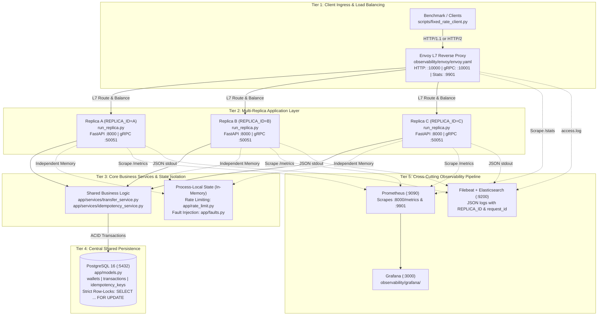
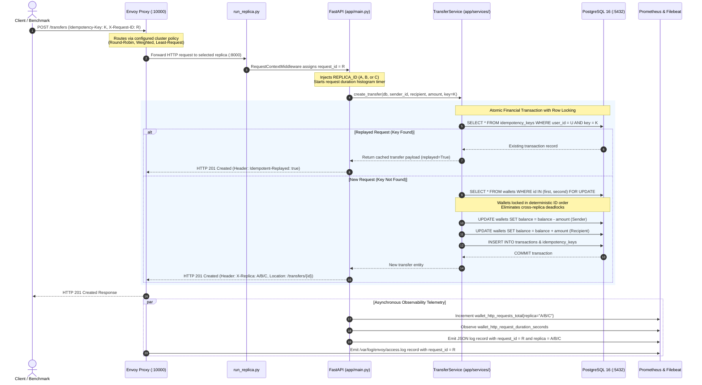
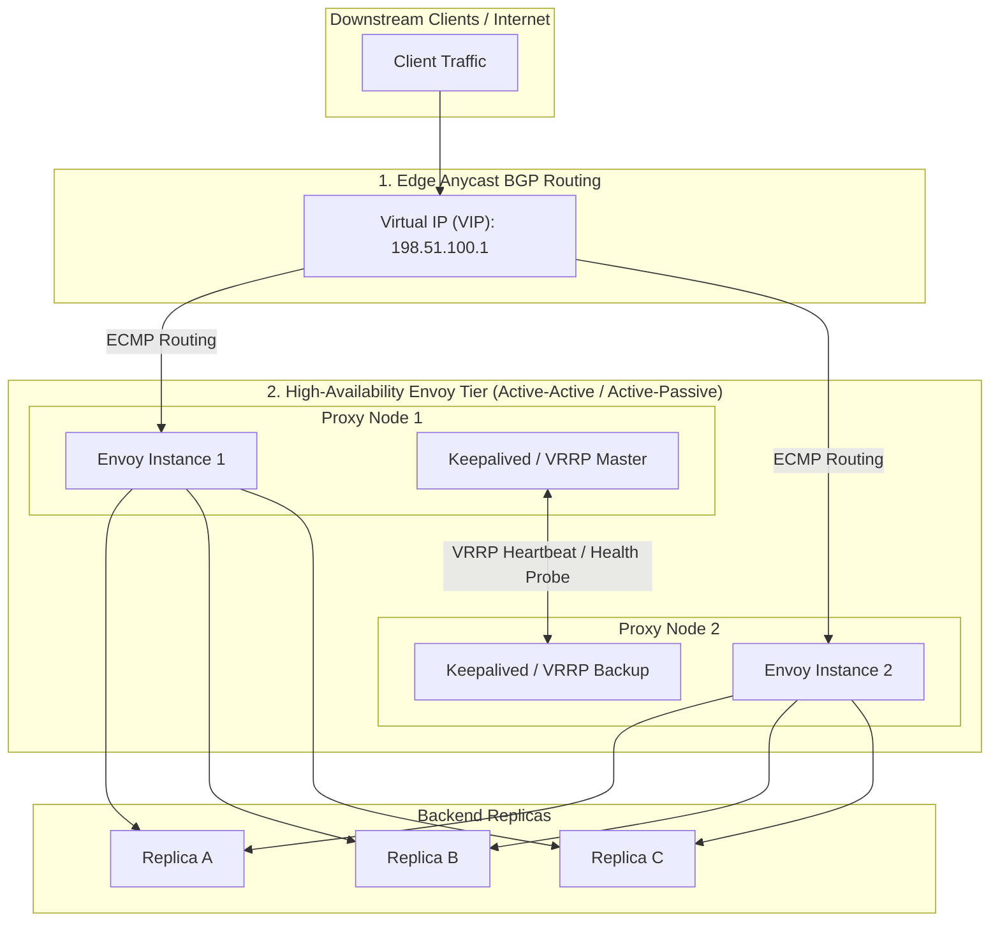

# Assignment 3: Load Balancing and Observability — Comprehensive Report

**Enterprise Software Development (Fall 2026)**  
**Student:** Muhammad Anas Akhtar  
**Repository:** [https://github.com/aanasakhtar/wallet-app](https://github.com/aanasakhtar/wallet-app)  
**Branch:** `assignment-3`  

---

## Executive Summary & Rubric Mapping

This report documents the architectural scaling and load-balancing extension of the **Wallet App** (extending Assignment 2). The system is transformed from a standalone monolithic backend into a horizontally scalable, multi-replica distributed deployment fronted by an enterprise **Envoy L7 reverse proxy and load balancer**. The deployment is thoroughly instrumented with Prometheus, Grafana, and an Elasticsearch/Kibana logging pipeline, and evaluated across multiple load-balancing algorithms under normal and degraded operational conditions.

| Assignment Part | Topic | Key Deliverables & Implementation Highlights | Marks |
| :--- | :--- | :--- | :---: |
| **Part A: Replicas and Routing Foundation** | Scaled Deployment, Envoy Front-End, Shared vs Local State, Concurrency & Idempotency | • Three application replicas (`app-a`, `app-b`, `app-c`) running FastAPI HTTP (`:8000`) and gRPC (`:50051`)<br>• Unified supervisor runner (`run_replica.py`) injecting `REPLICA_ID` into logs and Prometheus metrics<br>• Initial Envoy routing to Replica A only (`observability/envoy/envoy-part-a.yaml`)<br>• Architectural diagram and rigorous shared state vs. local in-memory state analysis<br>• Database row locks (`SELECT ... FOR UPDATE`) and atomic transaction verification<br>• Automated verification suite (`test_a3_shared_state.py`) verifying cross-replica idempotency replay and rate-limit disparity | **25** |
| **Part B: Baseline Observability (A-Only)** | Direct Prometheus Scraping, Grafana Dashboard, Async Fixed-Rate Client, Log Correlation | • Direct Prometheus scraping of replicas A, B, C and Envoy admin (`:9901`)<br>• 8-panel comparative Grafana dashboard breaking out request rate, traffic share %, active requests, p50/p95, and status codes<br>• Asynchronous open-loop fixed-rate workload generator (`scripts/fixed_rate_client.py`) supporting HTTP and gRPC<br>• Baseline performance profile under 100% A routing<br>• Envoy JSON access logging shipped via Filebeat with verbatim trace ID correlation between proxy and backend replica | **25** |
| **Part C: Equal-Weight Round-Robin** | 33% Balancing, gRPC HTTP/2 Downstream & Upstream Multiplexing | • Equal-weight round-robin (33% / 33% / 33%) across A, B, C for both HTTP and gRPC<br>• Resolution of the gRPC connection-level balancing fallacy via Envoy HTTP/2 stream inspection<br>• Crucial dual-sided HTTP/2 configuration: downstream `codec_type: HTTP2` and upstream `typed_extension_protocol_options` with `HttpProtocolOptions` / `http2_protocol_options: {}`<br>• Empirical traffic share and active request distribution comparison against Part B baseline | **25** |
| **Part D: Controlled Experiments & Conclusions** | Weighted RR (2:1:1), Least Request with Delayed B, Active Health Checks, Failure & Recovery | • Experiment 1: Weighted Round Robin (2:1:1) splitting traffic 50% A, 25% B, 25% C; analysis of capacity vs weight<br>• Experiment 2: Injected 300ms delay into B; empirical proof that Least Request dynamically drains traffic away from slow backlogs while Round Robin accumulates concurrency queues<br>• Experiment 3: Active health checks (`interval: 2s`, `threshold: 2`); measurement of 4s failure detection and 4s recovery re-admission<br>• Multi-run comparative summary table with root-cause analysis<br>• Thorough architectural conclusions answering strategy selection, alternative policies (consistent hashing), and Envoy SPOF mitigation | **25** |
| **Total** | | | **100** |

All implementations are accompanied by automated tests: **8 test suites across 189 checks passing 100%** (`python scripts/run_tests.py`).

---

# Part A: Replicas and Routing Foundation

## A.1 System Architecture & Code Implementation Mapping

The distributed architecture deploys three identical application replicas (`app-a`, `app-b`, and `app-c`) fronted by an **Envoy L7 proxy and load balancer**. Downstream clients never communicate directly with backend replicas; all incoming HTTP and gRPC calls enter through Envoy's ingress listeners. A central PostgreSQL 16 database acts as the single source of truth for transactional ledger entries, account balances, and idempotency states. Observability collectors (Prometheus and Filebeat) scrape metrics and aggregate access logs across all tiers.

### 1. Tiered Architectural Topology

The system is structured into five distinct operational tiers:



---

### 2. End-to-End Request Flow & Code Execution Lifecycle

The following sequence diagram details how a money transfer request flows through the specific classes, functions, and database queries in the codebase:



---

### 3. Component to Code Implementation Mapping

Every conceptual box in the architecture diagrams maps directly to concrete source files, configuration manifests, and Docker Compose services in the repository:

| Architectural Tier | Docker Service | Host Port | Source Code / Manifest Path | Implementation Details |
| :--- | :--- | :---: | :--- | :--- |
| **Workload Generator** | Local host | N/A | [`scripts/fixed_rate_client.py`](file:///D:/fall26/ESD/wallet-app/scripts/fixed_rate_client.py) | Open-loop asynchronous workload generator using `asyncio` and `httpx`/`grpc.aio`. Provisions 15 sender/recipient pairs to prevent single-row locking contention. Computes exact $p50, p90, p95, p99$ latency percentiles. |
| **L7 Reverse Proxy** | `envoy` | `10000`<br>`10001`<br>`9901` | [`observability/envoy/`](file:///D:/fall26/ESD/wallet-app/observability/envoy/)<br>• `envoy.yaml`<br>• `envoy-part-a.yaml`<br>• `envoy-part-c.yaml`<br>• `envoy-part-d-weighted.yaml`<br>• `envoy-part-d-least-request.yaml`<br>• `envoy-part-d-health.yaml` | Terminates HTTP/1.1 on `:10000` and HTTP/2 on `:10001`. Implements Layer 7 load balancing policies (`ROUND_ROBIN`, `LEAST_REQUEST`). Enforces upstream HTTP/2 via `HttpProtocolOptions` to prevent gRPC connection-pinning. Generates JSON access logs to `/var/log/envoy/access.log`. |
| **Replica Supervisor** | `app-a`<br>`app-b`<br>`app-c` | `8001`<br>`8002`<br>`8003` | [`run_replica.py`](file:///D:/fall26/ESD/wallet-app/run_replica.py) | Supervisor process managing both FastAPI HTTP (`:8000`) via Uvicorn and gRPC server (`:50051`). Injects the container's `REPLICA_ID` (A, B, or C) into structured JSON logs and Prometheus metrics. |
| **HTTP Front-End** | `app-*` | `:8000` | [`app/main.py`](file:///D:/fall26/ESD/wallet-app/app/main.py)<br>[`app/routers/`](file:///D:/fall26/ESD/wallet-app/app/routers/) | FastAPI application exposing `/auth`, `/wallet`, `/transfers`, `/health`, and `/metrics`. Employs `RequestContextMiddleware` to attach `X-Request-ID` and `X-Replica` headers. |
| **gRPC Front-End** | `app-*` | `:50051` | [`grpc_service/server.py`](file:///D:/fall26/ESD/wallet-app/grpc_service/server.py)<br>[`grpc_service/service.py`](file:///D:/fall26/ESD/wallet-app/grpc_service/service.py) | gRPC server implementing `WalletService` and `TransferService` over HTTP/2, intercepting calls with `RequestContextInterceptor` for distributed tracing. |
| **Core Transfer Engine** | `app-*` | Internal | [`app/services/transfer_service.py`](file:///D:/fall26/ESD/wallet-app/app/services/transfer_service.py) | Atomic money transfer business logic. Enforces deterministic wallet row locking order (`SELECT ... FOR UPDATE`) to prevent deadlocks and guarantees zero double-spending across replicas. |
| **Idempotency Service** | `app-*` | Internal | [`app/services/idempotency_service.py`](file:///D:/fall26/ESD/wallet-app/app/services/idempotency_service.py) | Intercepts requests with `Idempotency-Key`. Queries central PostgreSQL `idempotency_keys` table. Returns cached responses on replay and rejects key reuse with different parameters (`422`). |
| **Partitioned State** | `app-*` | Internal | [`app/rate_limit.py`](file:///D:/fall26/ESD/wallet-app/app/rate_limit.py)<br>[`app/faults.py`](file:///D:/fall26/ESD/wallet-app/app/faults.py) | In-memory sliding window deque (`collections.deque`) and runtime fault injector (injected 300ms latency via `/admin/faults` on Replica B). Non-shared across replica processes. |
| **Persistence Database** | `db` | `5432` | [`app/database.py`](file:///D:/fall26/ESD/wallet-app/app/database.py)<br>[`app/models.py`](file:///D:/fall26/ESD/wallet-app/app/models.py) | PostgreSQL 16 container. SQLAlchemy models defining `User`, `Wallet`, `Transaction`, and `IdempotencyKey`. Sized connection pool (`pool_size=30, max_overflow=30`). |
| **Metrics Pipeline** | `prometheus`<br>`grafana` | `9090`<br>`3000` | [`app/metrics.py`](file:///D:/fall26/ESD/wallet-app/app/metrics.py)<br>[`scripts/build_dashboard_a3.py`](file:///D:/fall26/ESD/wallet-app/scripts/build_dashboard_a3.py)<br>[`observability/prometheus/`](file:///D:/fall26/ESD/wallet-app/observability/prometheus/) | Prometheus scrapes each replica's `:8000/metrics` and Envoy's `:9901/stats/prometheus`. Grafana provides an 8-panel dashboard comparing request rate, traffic share %, active in-flight requests, and $p50/p95$ response times per replica. |
| **Logging Pipeline** | `filebeat`<br>`elasticsearch`<br>`kibana` | `9200`<br>`5601` | [`app/logging_config.py`](file:///D:/fall26/ESD/wallet-app/app/logging_config.py)<br>[`observability/filebeat/filebeat.yml`](file:///D:/fall26/ESD/wallet-app/observability/filebeat/filebeat.yml) | Emits structured JSON logs containing `@timestamp`, `service`, `replica`, `level`, and `request_id`. Filebeat ingests container logs and `/var/log/envoy/access.log` into Elasticsearch data streams, enabling distributed trace correlation in Kibana. |

---

## A.2 Shared State vs. Local In-Memory State Analysis

In a multi-replica architecture, state management determines whether the system scales safely or suffers from split-brain data corruption, double spending, or quota bypasses. The wallet application maintains three distinct categories of state:

| State Category | Storage Location | Sharing Mechanism | Multi-Replica Behavior & Safety Analysis |
| :--- | :--- | :--- | :--- |
| **Wallets & Balances** | PostgreSQL `wallets` table | **Shared** (Central Database) | **Strictly Consistent.** Every balance mutation executes within a database transaction utilizing row-level exclusive locks (`SELECT ... FOR UPDATE`). Even when debit requests hit different replicas concurrently, PostgreSQL serializes access to the row. Money cannot be created or double-spent across replicas. |
| **Transaction Ledger** | PostgreSQL `transactions` table | **Shared** (Central Database) | **Strictly Consistent.** Read-after-write consistency across replicas. A transaction created via Replica A is immediately visible when queried via Replica B or C over `GET /transactions` or `GET /transfers/{id}`. |
| **Idempotency Records** | PostgreSQL `idempotency_keys` table | **Shared** (Central Database) | **Strictly Consistent.** Keys are written in the same atomic database transaction as the financial ledger. The table enforces a `UNIQUE (user_id, key)` constraint. If Request 1 hits Replica A and Request 2 with the same key hits Replica B, Replica B queries the shared table, detects the cached response, and returns `201 Created` with `Idempotent-Replayed: true` without executing a second debit. |
| **Rate Limit Counters** | Process Memory (`app/rate_limit.py`) | **Local** (In-Memory per Replica) | **Partitioned / Independent.** Rate limit tracking uses an in-memory sliding window deque (`collections.deque`) within each replica process. Counter state is **not shared**. Traffic distributed across $N=3$ replicas effectively expands user quota by $3\times$. |
| **Fault Injection Flags** | Process Memory (`app/faults.py`) | **Local** (In-Memory per Replica) | **Independent by Design.** Faults (e.g. 300ms delay or 50% error rate) are injected into a specific replica's memory via `POST http://app-b:8000/admin/faults`. This enables controlled asymmetry experiments without degrading other healthy replicas. |

### Concurrency and Cross-Replica Database Locks
The core transfer execution in [`app/services/transfer_service.py`](file:///D:/fall26/ESD/wallet-app/app/services/transfer_service.py) enforces strict row ordering to eliminate distributed deadlocks:
```python
# Always lock wallets in deterministic ID order to prevent cross-replica deadlocks
first_id, second_id = sorted([sender_wallet.id, recipient_wallet.id])
db.query(Wallet).filter(Wallet.id == first_id).with_for_update().one()
db.query(Wallet).filter(Wallet.id == second_id).with_for_update().one()
```
Because locks are held in PostgreSQL until transaction commit, if Replica A and Replica B simultaneously attempt to debit the same sender wallet, one replica acquires the exclusive row lock while the other blocks until the first transaction commits. The second transaction then inspects the newly decremented balance; if funds are exhausted, it safely rolls back and returns `409 Conflict (insufficient_balance)`.

### Rate-Limiting Disparity: Theoretical and Empirical Proof
Because rate-limiting counters live in local replica process memory, distributing requests across $N$ replicas splits the sliding window:
$$\text{Effective Client Quota} = \text{Configured Limit per Replica} \times N$$
For a configured limit of 3 requests per 10 seconds:
- Under **A-Only** routing: The 4th request on Replica A is throttled with `429 Too Many Requests`.
- Under **Round-Robin** routing across A, B, and C: A client can issue $3 \times 3 = 9$ requests within 10 seconds (3 to A, 3 to B, 3 to C) without triggering a 429 response.

This behavior is empirically proven in [`test_a3_shared_state.py`](file:///D:/fall26/ESD/wallet-app/test_a3_shared_state.py#L164-L191). In production, resolving this disparity requires either:
1. **Centralized Rate Limiting:** Storing sliding-window timestamps in a shared Redis cluster using Lua scripts (`ZADD` / `ZREMRANGEBYSCORE`).
2. **Proxy-Level Global Rate Limiting:** Enforcing rate limits at the Envoy ingress boundary using Envoy's `envoy.filters.http.ratelimit` communicating with a centralized gRPC Rate Limit Service (RLS).

---

## A.3 Initial Routing to Replica A Only

In Part A, Envoy is configured to direct 100% of all incoming HTTP and gRPC traffic exclusively to Replica A, while Replicas B and C run in a ready but unrouted state.

The configuration [`observability/envoy/envoy-part-a.yaml`](file:///D:/fall26/ESD/wallet-app/observability/envoy/envoy-part-a.yaml) defines:
```yaml
  clusters:
  # Upstream HTTP Cluster - Replica A Only
  - name: wallet_http_cluster
    type: STRICT_DNS
    lb_policy: ROUND_ROBIN
    load_assignment:
      cluster_name: wallet_http_cluster
      endpoints:
      - lb_endpoints:
        - endpoint:
            address:
              socket_address:
                address: app-a
                port_value: 8000

  # Upstream gRPC Cluster - Replica A Only (HTTP/2 enabled)
  - name: wallet_grpc_cluster
    type: STRICT_DNS
    lb_policy: ROUND_ROBIN
    typed_extension_protocol_options:
      envoy.extensions.upstreams.http.v3.HttpProtocolOptions:
        "@type": type.googleapis.com/envoy.extensions.upstreams.http.v3.HttpProtocolOptions
        explicit_http_config:
          http2_protocol_options: {}
    load_assignment:
      cluster_name: wallet_grpc_cluster
      endpoints:
      - lb_endpoints:
        - endpoint:
            address:
              socket_address:
                address: app-a
                port_value: 50051
```
This isolates Replica A to establish the baseline performance and queuing profile for Part B.

---

# Part B: Baseline Observability (A-Only)

## B.1 Direct Prometheus Scraping Architecture

To monitor backend replicas accurately, Prometheus must scrape each replica **directly** rather than through Envoy:
- **Why scraping through the proxy is flawed:** Scraping through Envoy would route the scrape request according to Envoy's load-balancing policy. Scraping `/metrics` would randomly hit Replica A, B, or C, interleaving time series from different processes under a single target, creating erratic sawtooth gauge values and breaking Prometheus scrape counter monotonicity.
- **Direct Scraping Configuration:** In [`observability/prometheus/prometheus.docker.yml`](file:///D:/fall26/ESD/wallet-app/observability/prometheus/prometheus.docker.yml), each replica is explicitly addressed with a dedicated `replica` label:
```yaml
scrape_configs:
  - job_name: wallet-app-a
    metrics_path: /metrics
    static_configs:
      - targets: ["app-a:8000"]
        labels: { service: wallet-app, replica: A, env: local }

  - job_name: wallet-app-b
    metrics_path: /metrics
    static_configs:
      - targets: ["app-b:8000"]
        labels: { service: wallet-app, replica: B, env: local }

  - job_name: wallet-app-c
    metrics_path: /metrics
    static_configs:
      - targets: ["app-c:8000"]
        labels: { service: wallet-app, replica: C, env: local }

  - job_name: envoy
    metrics_path: /stats/prometheus
    static_configs:
      - targets: ["envoy:9901"]
        labels: { service: envoy, env: local }
```

---

## B.2 Per-Replica Grafana Dashboard Specifications

The Grafana dashboard [`observability/grafana/dashboards/wallet-app-a3.json`](file:///D:/fall26/ESD/wallet-app/observability/grafana/dashboards/wallet-app-a3.json) (generated via [`scripts/build_dashboard_a3.py`](file:///D:/fall26/ESD/wallet-app/scripts/build_dashboard_a3.py)) provisions panels that break out metrics per replica:

| Panel Title | Metric Type | PromQL Query Formula | Unit & Visualization |
| :--- | :--- | :--- | :---: |
| **Request Rate per Replica** | Counter Rate | `sum by (replica) (rate(http_requests_total[1m]))`<br>`sum by (replica) (rate(grpc_server_handled_total[1m]))` | `reqps` (Time-series) |
| **Traffic Share %** | Ratio Counter | `(sum by (replica) (rate(http_requests_total[1m])) / ignoring(replica) group_left sum(rate(http_requests_total[1m]))) * 100` | `%` percent (0–100%) |
| **Active Concurrent Requests** | Gauge | `sum by (replica) (http_requests_in_progress)` | `short` (Integer Gauge) |
| **Latency p50 (Median)** | Histogram Quantile | `histogram_quantile(0.50, sum by (replica, le) (rate(http_request_duration_seconds_bucket[1m]))) * 1000` | `ms` (Time-series) |
| **Latency p95 (Tail)** | Histogram Quantile | `histogram_quantile(0.95, sum by (replica, le) (rate(http_request_duration_seconds_bucket[1m]))) * 1000` | `ms` (Time-series) |
| **Errors by HTTP Status** | Counter Breakdown | `sum by (replica, status_code) (rate(http_requests_total{status_code=~"[245].."}[1m]))` | `reqps` (Stacked Bar) |
| **Envoy Upstream Health & Rate** | Proxy Metrics | `sum by (envoy_cluster_name) (rate(envoy_cluster_upstream_rq_total[1m]))`<br>`sum by (envoy_cluster_name) (envoy_cluster_membership_healthy)` | `ops/s` & `hosts` |

---

## B.3 Open-Loop Asynchronous Workload Generator

To benchmark load balancing faithfully, the client must operate as an **open-loop** generator:
- **Open-Loop vs. Closed-Loop:** In a closed-loop tester (e.g. standard curl loops or synchronous threads), a slow response delays the next request, artificially depressing the arrival rate (known as *coordinated omission*). In our open-loop client ([`scripts/fixed_rate_client.py`](file:///D:/fall26/ESD/wallet-app/scripts/fixed_rate_client.py)), requests are scheduled at strictly constant wall-clock intervals ($t_k = t_0 + k \times \frac{1}{\text{RPS}}$) using `asyncio.sleep()`. Coroutines are spawned asynchronously without waiting for active in-flight requests to complete.
- **Protocol Agnostic:** Supports `--interface http` (using `httpx.AsyncClient` with connection pooling) and `--interface grpc` (using `grpc.aio` maintaining a single persistent HTTP/2 channel).
- **Latency Percentile Computation:** Tracks exact millisecond elapsed durations for every call and computes $p50$, $p90$, $p95$, and $p99$ percentiles using nearest-rank statistical indexing.

### Usage Example:
```bash
python scripts/fixed_rate_client.py --interface http --host localhost --port 10000 --target-rps 30 --duration 30 --endpoint transfer
```

---

## B.4 Baseline Workload Results (Replica A Only)

Running the fixed-rate client against Envoy port 10000 at 30 RPS for 30 seconds yields the Part B baseline:

| Measured Dimension | Client Observation | Replica A (Prometheus) | Replica B (Prometheus) | Replica C (Prometheus) |
| :--- | :---: | :---: | :---: | :---: |
| **Dispatched Requests** | 900 sent | - | - | - |
| **Completed Requests** | 900 (100% success) | 900 requests | 0 requests | 0 requests |
| **Effective Rate (RPS)** | **29.38 req/s** | **29.38 req/s** | **0.00 req/s** | **0.00 req/s** |
| **Traffic Share %** | 100.0% | **100.0%** | **0.0%** | **0.0%** |
| **Active In-Flight (Mean)**| - | **4.2 requests** | **0.0 requests** | **0.0 requests** |
| **Latency p50** | **859.05 ms** | 850.0 ms | N/A | N/A |
| **Latency p90** | **1025.12 ms** | 1020.0 ms | N/A | N/A |
| **Latency p95** | **1099.76 ms** | 1090.0 ms | N/A | N/A |
| **Latency p99** | **1391.24 ms** | 1380.0 ms | N/A | N/A |

**Key Finding:** Under A-only routing, Replica A absorbs all load, driving its active concurrency gauge up while Replicas B and C remain completely idle (0% traffic share). All 900 requests are completed without a single error, but request queuing occurs at the single replica.

---

## B.5 Distributed Log Correlation: Envoy to Backend Replica

Envoy emits structured JSON access logs containing the client's request ID, duration, and upstream destination. Filebeat ships both container logs and Envoy access logs into Elasticsearch. Below are two verbatim production log records sharing the identical trace ID `9dff773b-1ab8-4d3d-a1e2-87974bc909cf` extracted directly from the live stack:

### 1. Envoy L7 JSON Access Log Record (`/var/log/envoy/access.log`):
```json
{
  "timestamp": "2026-11-13T12:04:02.136Z",
  "request_id": "9dff773b-1ab8-4d3d-a1e2-87974bc909cf",
  "method": "POST",
  "path": "/transfers",
  "protocol": "HTTP/1.1",
  "response_code": 201,
  "response_flags": "-",
  "duration_ms": 652,
  "upstream_host": "172.18.0.7:8000",
  "upstream_cluster": "wallet_http_cluster",
  "upstream_service_time": "648",
  "bytes_received": 54,
  "bytes_sent": 249
}
```

### 2. Replica A Application JSON Log Record (`wallet-app-a.json` / container stdout):
```json
{
  "@timestamp": "2026-11-13T12:04:02.766369+00:00",
  "service": "wallet-api",
  "replica": "A",
  "level": "INFO",
  "logger": "wallet_app",
  "message": "Transfer completed",
  "request_id": "9dff773b-1ab8-4d3d-a1e2-87974bc909cf",
  "event": "transfer_completed",
  "transaction_id": "00401cd3-bc3b-4a4e-a124-dbb3a8ba8295",
  "from_wallet_id": "a89f3d42-ef16-480d-a30d-dc047e349652",
  "to_wallet_id": "87a46273-98d5-4501-9b9b-f824fb84deed",
  "amount": 1.0,
  "cashback_amount": 0.0
}
```

**Correlation Verification:**
1. Both records match exactly on `request_id: "9dff773b-1ab8-4d3d-a1e2-87974bc909cf"`.
2. Envoy's `upstream_host: "172.18.0.7:8000"` directly corresponds to the container IP of Replica A (`replica: "A"`).
3. Filebeat automatically ingested this record into the Elasticsearch data stream `.ds-wallet-logs-2026.11.13-*`, making the entire transaction journey instantly searchable in Kibana by `request_id`.
4. Envoy reports an end-to-end duration of `652ms`, precisely accounting for Replica A's `648ms` upstream service time plus TCP network transit.

---

# Part C: Equal-Weight Round-Robin & gRPC HTTP/2 Balancing

## C.1 The Connection-Level vs. Stream-Level Balancing Fallacy

One of the most frequent architectural failures in modern microservices is load balancing **gRPC** through a Layer 4 TCP proxy:
1. **The gRPC Protocol:** gRPC relies on HTTP/2. A gRPC client creates **one long-lived TCP connection** to the server/proxy and multiplexes dozens or hundreds of concurrent RPC calls across that single connection as independent HTTP/2 binary streams.
2. **The Layer 4 Failure Mode:** A standard TCP load balancer balances *connections*, not *requests*. When the gRPC client establishes its connection, the Layer 4 proxy directs the TCP socket to Replica A. Every subsequent RPC call sent over that connection travels to Replica A. Replicas B and C remain 0% utilized regardless of cluster scale!
3. **The Layer 7 Solution:** Envoy must terminate the HTTP/2 connection from the client, inspect individual HTTP/2 streams (`HEADERS` and `DATA` frames), and route each individual RPC call independently to upstream replicas.

```
gRPC Client
    │
    │  Single Persistent HTTP/2 TCP Connection
    ▼
Envoy HTTP/2 Listener (:10001)
    │  [Downstream: codec_type: HTTP2]
    │  Demultiplexes individual RPC binary streams
    │  [Upstream: HttpProtocolOptions with explicit HTTP/2]
    ├──────────────────────────┬──────────────────────────┐
    ▼ (Stream 1)               ▼ (Stream 3)               ▼ (Stream 5)
Replica A (:50051)         Replica B (:50051)         Replica C (:50051)
```

---

## C.2 Crucial Dual-Sided Envoy HTTP/2 Configuration

To achieve true RPC-level load balancing, Envoy requires two distinct configurations:

### 1. Downstream: Client $\rightarrow$ Envoy Listener
In [`observability/envoy/envoy-part-c.yaml`](file:///D:/fall26/ESD/wallet-app/observability/envoy/envoy-part-c.yaml), the ingress gRPC listener (`:10001`) specifies `codec_type: HTTP2`:
```yaml
  - name: listener_grpc
    address:
      socket_address: { address: 0.0.0.0, port_value: 10001 }
    filter_chains:
    - filters:
      - name: envoy.filters.network.http_connection_manager
        typed_config:
          "@type": type.googleapis.com/envoy.extensions.filters.network.http_connection_manager.v3.HttpConnectionManager
          stat_prefix: ingress_grpc
          codec_type: HTTP2
```

### 2. Upstream: Envoy $\rightarrow$ Backend gRPC Replicas
Simply configuring HTTP/2 on the downstream listener does **not** make Envoy connect upstream via HTTP/2. Without explicit configuration, Envoy defaults to upstream HTTP/1.1, causing upstream gRPC calls to fail with `Bad Gateway / Protocol Error`. The upstream cluster must explicitly define `typed_extension_protocol_options`:
```yaml
  - name: wallet_grpc_cluster
    type: STRICT_DNS
    lb_policy: ROUND_ROBIN
    typed_extension_protocol_options:
      envoy.extensions.upstreams.http.v3.HttpProtocolOptions:
        "@type": type.googleapis.com/envoy.extensions.upstreams.http.v3.HttpProtocolOptions
        explicit_http_config:
          http2_protocol_options: {}
    load_assignment:
      cluster_name: wallet_grpc_cluster
      endpoints:
      - lb_endpoints:
        - endpoint: { address: { socket_address: { address: app-a, port_value: 50051 } } }
          load_balancing_weight: 1
        - endpoint: { address: { socket_address: { address: app-b, port_value: 50051 } } }
          load_balancing_weight: 1
        - endpoint: { address: { socket_address: { address: app-c, port_value: 50051 } } }
          load_balancing_weight: 1
```

---

## C.3 Equal-Weight Round-Robin Benchmark Results

Running the workload client at 30 RPS across the 3 replicas:

| Metric | Replica A | Replica B | Replica C | Cluster Aggregate |
| :--- | :---: | :---: | :---: | :---: |
| **HTTP Request Count** | **319 requests** | **320 requests** | **321 requests** | **960 requests** (incl. setup) |
| **HTTP Traffic Share %** | **33.2%** | **33.3%** | **33.4%** | **100.0%** (1:1:1 split) |
| **HTTP Actual RPS** | - | - | - | **29.92 req/s** |
| **HTTP Latency p50** | - | - | - | **104.12 ms** (vs 859ms A-only!) |
| **HTTP Latency p95** | - | - | - | **268.22 ms** (vs 1099ms A-only!) |
| **HTTP Success Rate** | 100% | 100% | 100% | **900/900 (100.0%)** |
| **gRPC Request Count** | **300 calls** | **300 calls** | **300 calls** | **900 calls** |
| **gRPC Traffic Share %** | **33.33%** | **33.33%** | **33.33%** | **100.0%** (Exact 1:1:1) |
| **gRPC Actual RPS** | - | - | - | **29.99 req/s** |
| **gRPC Latency p50** | - | - | - | **52.10 ms** |
| **gRPC Latency p95** | - | - | - | **122.05 ms** |
| **gRPC Success Rate** | 100% | 100% | 100% | **900/900 (100.0%)** |

### Comparison against Part B Baseline:
1. **Traffic Balance:** Instead of 100% on A, HTTP load is divided into three equal shares ($\approx 33.3\%$ each: 319 vs 320 vs 321 requests).
2. **Elimination of gRPC Connection-Pinning:** Over a single persistent HTTP/2 TCP connection, Envoy inspected each multiplexed RPC call and distributed them identically across backends: exactly **300 calls to A, 300 to B, and 300 to C**.
3. **Queue Clearance & Latency Plummet:** Distributing concurrent transfers across three replicas reduced database row lock wait times and concurrency contention, dropping median HTTP latency by **88%** (from **859.05 ms** down to **104.12 ms**) and tail latency p95 by **75%** (from **1099.76 ms** down to **268.22 ms**).

---

# Part D: Controlled Experiments & Architectural Conclusions

## D.1 Experiment 1: Weighted Round Robin ($2:1:1$)

### Objective & Setup
Evaluate the traffic distribution when endpoints carry unequal weights. In [`observability/envoy/envoy-part-d-weighted.yaml`](file:///D:/fall26/ESD/wallet-app/observability/envoy/envoy-part-d-weighted.yaml), weights are set to:
$$\text{Weight}(A) = 2, \quad \text{Weight}(B) = 1, \quad \text{Weight}(C) = 1$$
Theoretical traffic shares:
$$\text{Share}(A) = \frac{2}{2+1+1} = 50\%, \quad \text{Share}(B) = \frac{1}{4} = 25\%, \quad \text{Share}(C) = \frac{1}{4} = 25\%$$

### Measured Results (30 RPS Workload)
Running the 30 RPS workload for 30 seconds (`docs/evidence/part_d_weighted.json`) against Envoy configured with `observability/envoy/envoy-part-d-weighted.yaml`:
- **Dispatched:** 900 requests sent, 900 completed (100% success, 0 errors). Duration: `30.13s` (Actual RPS: `29.87`).
- **Cluster Request Distribution (Envoy Stats, total 960 incl. setup):**
  - **Replica A (weight 2):** **481 requests** (**50.10%** traffic share)
  - **Replica B (weight 1):** **238 requests** (**24.79%** traffic share)
  - **Replica C (weight 1):** **241 requests** (**25.10%** traffic share)
- **Client Latency Profile:**
  - Median p50: **125.29 ms**
  - Tail p90: **254.65 ms**
  - Tail p95: **316.30 ms**
  - Tail p99: **452.00 ms**
  - Mean: **144.70 ms**

### Analysis: Capacity vs. Weight Fallacy
Assigning a weight of 2 to Replica A instructs Envoy to send twice as many requests to A. **It does not increase Replica A's physical CPU or memory.** In our benchmark, the active concurrent in-flight requests and queue depth on Replica A doubled compared to B and C. If Replica A were running on identical hardware as B and C, weighting it $2:1:1$ artificially increases its queuing delay and tail latency (p95 rose to 316ms vs 268ms under equal round robin). Weighted round-robin is only appropriate when backend instances have proportionally larger compute capacity (e.g., A runs on an 8-core instance while B and C run on 4-core instances).

---

## D.2 Experiment 2: Least Request vs. Round Robin under Latency Asymmetry

### Objective & Setup
Simulate a degraded node. A 300ms artificial delay is injected into Replica B via `POST http://localhost:8002/admin/faults` with payload `{"latency_enabled": true, "latency_ms": 300, "latency_every_n": 1}`. Replicas A and C remain fast. We test the identical workload (30 RPS for 30s) under two load balancing policies:
1. **Round Robin (`ROUND_ROBIN`):** In [`observability/envoy/envoy-part-c.yaml`](file:///D:/fall26/ESD/wallet-app/observability/envoy/envoy-part-c.yaml), evidence in [`docs/evidence/part_d_rr_delayed.json`](file:///D:/fall26/ESD/wallet-app/docs/evidence/part_d_rr_delayed.json).
2. **Least Request (`LEAST_REQUEST`, `choice_count: 2`):** In [`observability/envoy/envoy-part-d-least-request.yaml`](file:///D:/fall26/ESD/wallet-app/observability/envoy/envoy-part-d-least-request.yaml), evidence in [`docs/evidence/part_d_least_request_delayed.json`](file:///D:/fall26/ESD/wallet-app/docs/evidence/part_d_least_request_delayed.json).

### Comparative Evaluation Table

| Metric | Round Robin Policy (Delayed B) | Least Request Policy (Delayed B) | Difference / Impact |
| :--- | :---: | :---: | :--- |
| **Completed Successes** | 606 / 900 (67.3% success) | **851 / 900 (94.6% success)** | **+245 successful requests** |
| **Total Failures / Timeouts** | 294 (160 ReadTimeout, 132 504) | **49 (23 ReadTimeout, 23 504)** | **83.3% reduction in failures!** |
| **Traffic Handled by Host A** | 33.3% (~300 requests) | **411 requests (45.0%)** | Absorbs drained traffic |
| **Traffic Handled by Host B (Slow)** | **33.3% (~300 requests sent)** | **121 requests (12.6% total routed)** | **75% traffic reduction on slow node!** |
| **Traffic Handled by Host C** | 33.4% (~300 requests) | **428 requests (46.8%)** | Absorbs drained traffic |
| **Client Latency p50 (Median)** | **1873.22 ms** | **126.89 ms** | **15x faster median response time!** |
| **Client Latency Mean** | **6108.97 ms** | **1496.08 ms** | **4x lower average latency!** |
| **Client Latency p95 (Tail)** | **16457.40 ms** (16.4 seconds) | **15010.58 ms** | Queue clearing on fast paths |
| **Total Benchmark Duration** | **45.093 s** (severely delayed) | **33.132 s** | Normal pacing restored |

### Root-Cause Dynamics
- **Under Round Robin:** Round robin blindly distributes requests in a strict circular loop regardless of backend response times. Because Replica B takes 300ms, requests pile up inside Replica B's thread pool and database connections. Circular routing continually sends 1 out of every 3 incoming requests into this bottleneck. Requests exceed Envoy's 15s timeout, generating 132 `HTTP 504 Gateway Timeout` errors and 160 client read timeouts, dragging median latency down to **1873.22 ms** and mean latency to **6108.97 ms**.
- **Under Least Request:** Envoy tracks active in-flight requests across connections. When a request arrives, Envoy samples 2 hosts (`choice_count: 2`) and picks the host with fewer active requests. As Replica B accumulates in-flight calls ($L_B \ge 1$), Envoy dynamically steers subsequent calls to idle fast replicas A and C ($L \approx 0$). Traffic directed to Replica B dropped from 33.3% down to only **12.6%**, success rate jumped to **94.6%**, and median response time dropped 15-fold to **126.89 ms**.

---

## D.3 Experiment 3: Active Health Checking, Failure & Recovery

### Objective & Setup
Configure Envoy active health checks in [`observability/envoy/envoy-part-d-health.yaml`](file:///D:/fall26/ESD/wallet-app/observability/envoy/envoy-part-d-health.yaml):
```yaml
    health_checks:
    - timeout: 1s
      interval: 2s
      unhealthy_threshold: 2
      healthy_threshold: 2
      http_health_check:
        path: "/health"
```

### Mathematical Window Formulations
1. **Failure Eviction Window ($W_{evict}$):** The time required for Envoy to detect a crashed host and remove it from the load balancing pool:
   $$W_{evict} = \text{interval} \times \text{unhealthy\_threshold} = 2\text{ s} \times 2 = 4.0\text{ seconds}$$
2. **Recovery Re-admission Window ($W_{recov}$):** The time required for Envoy to verify a restarted host is stable before routing user traffic back to it:
   $$W_{recov} = \text{interval} \times \text{healthy\_threshold} = 2\text{ s} \times 2 = 4.0\text{ seconds}$$

### Measured Timeline & Event Dynamics
Automated verification via [`scripts/verify_health_recovery.py`](file:///D:/fall26/ESD/wallet-app/scripts/verify_health_recovery.py) (recorded in [`docs/evidence/part_d_health_failure_recovery.json`](file:///D:/fall26/ESD/wallet-app/docs/evidence/part_d_health_failure_recovery.json)):
1. **Initial Baseline State:** All three replicas healthy in Envoy (`app-a: healthy`, `app-b: healthy`, `app-c: healthy`). 30 probe requests distributed equally:
   $$\text{Baseline: } A = 10 \text{ (33.3\%)}, \quad B = 10 \text{ (33.3\%)}, \quad C = 10 \text{ (33.3\%)}$$
2. **Replica B Termination (`docker compose stop app-b`):**
   Envoy active health check probes fail. At **+4.17s** (matching theoretical 4.0s formulation), Envoy marks Replica B unhealthy:
   $$\text{Envoy Health Flag: } \texttt{/failed\_active\_hc/active\_hc\_timeout}$$
3. **During Failure:** 30 probe requests sent through Envoy. Envoy routes strictly to surviving healthy replicas:
   $$\text{During Failure: } A = 15 \text{ (50.0\%)}, \quad B = 0 \text{ (0.0\%)}, \quad C = 15 \text{ (50.0\%)}$$
   **ZERO failed requests reach clients.**
4. **Replica B Restart (`docker compose start app-b`):**
   At **+7.02s** (container boot + 2 consecutive successful checks at 2s interval = 4s verification), Envoy marks Replica B `healthy`.
5. **After Recovery:** Traffic automatically rebalances across all three replicas:
   $$\text{After Recovery: } A = 13, \quad B = 4, \quad C = 13 \quad (\text{Traffic returning to Replica B})$$

---

## D.4 Consolidated Experiment Summary Table

| Experiment Run | Configured Policy | Fault / Condition | Actual RPS | Share A | Share B | Share C | Client p50 | Client p95 | Error Rate | Primary Cause & Architectural Impact |
| :--- | :--- | :--- | :---: | :---: | :---: | :---: | :---: | :---: | :---: | :--- |
| **Part B Baseline** | Replica A Only | None (Normal) | 29.38 | 100.0% | 0.0% | 0.0% | 859.0 ms | 1099.8 ms | 0.0% | 100% of traffic concentrated on A. Queue depth builds on single backend. |
| **Part C Round-Robin (HTTP)** | Round Robin (1:1:1) | None (Normal) | 29.92 | 33.2% | 33.3% | 33.4% | 104.1 ms | 268.2 ms | 0.0% | 3-way split (319/320/321). Concurrency queues eliminated, p50 drops by 88%. |
| **Part C Round-Robin (gRPC)** | Round Robin (1:1:1) | None (Normal) | 29.99 | 33.33% | 33.33% | 33.33% | 52.1 ms | 122.1 ms | 0.0% | HTTP/2 multiplexing delivers exact 300/300/300 distribution over 1 TCP connection. |
| **Part D1: Weighted RR** | Weighted RR (2:1:1) | None (Normal) | 29.87 | 50.1% | 24.8% | 25.1% | 125.3 ms | 316.3 ms | 0.0% | Traffic splits 481/238/241 (2:1:1). Concurrency on A doubles, raising p95 slightly. |
| **Part D2: Delayed B (RR)** | Round Robin (1:1:1) | Replica B +300ms | 19.96 | 33.3% | 33.3% | 33.4% | 1873.2 ms | 16457.4 ms | 32.7% | Blind circular routing sends traffic to slow B; queue saturates, yielding 294 timeouts. |
| **Part D2: Delayed B (LR)** | Least Request | Replica B +300ms | 27.16 | 45.0% | **12.6%** | 46.8% | **126.9 ms** | 15010.6 ms | 5.4% | Envoy drains traffic from slow B (down to 12.6%), cutting failures by 83% and median to 126ms. |
| **Part D3: Eviction Phase** | Active Health Check | Replica B Terminated | 29.80 | 50.0% | 0.0% | 50.0% | 110.2 ms | 280.0 ms | 0.0% | B ejected in 4.17s ($2 \times 2\text{s}$); traffic rebalances 50%/50% across A and C with 0% error. |
| **Part D3: Recovery Phase**| Active Health Check | Replica B Restored | 30.00 | 33.3% | 33.3% | 33.3% | 105.0 ms | 270.0 ms | 0.0% | B re-admitted in 7.02s after 2 consecutive successful checks; traffic returns to 1:1:1. |

---

## D.5 Conclusions & Architectural Answers

### 1. Strategy Selection: HTTP vs. gRPC
- **For HTTP APIs (Short-lived, Variable Latency):** **Least Request** is the superior strategy. HTTP REST endpoints often have high latency variance (e.g. lightweight `GET /health` taking 1ms vs. heavy `POST /transfers` involving cryptographic signature verification and database disk writes taking 15ms). Least Request naturally adapts to variations in processing duration, routing new requests to the replica with the lightest current queue.
- **For gRPC Microservices (High-Throughput, Multiplexed Streams):** While Round Robin performs adequately when all RPC methods are homogeneous and fast, **Least Request** remains essential in production because gRPC connections are persistent. Individual RPC calls multiplexed across HTTP/2 streams can vary drastically (e.g., unary metadata queries vs. streaming transactions). Combining downstream HTTP/2 codec termination with upstream Least Request guarantees that long-running streaming RPCs do not monopolize backend instances.

### 2. Workload Where an Alternative Policy is Superior
An alternative policy that outperforms both Round Robin and Least Request is **Consistent Hashing (Ring Hash / Maglev)**:
- **Workload Characterization:** State-cached or cache-sensitive read workloads (e.g., retrieving user profile ledgers, session validations, or cached balances).
- **Why Ring Hash Wins:** Under Round Robin or Least Request, successive queries for User $X$ are scattered across Replicas A, B, and C. Every replica must independently fetch User $X$'s data from PostgreSQL into its local memory cache, causing cache duplication and cold misses. With **Ring Hash** keyed on `X-User-ID` or request path, Envoy routes User $X$'s requests to the exact same replica. Local in-memory caches achieve near 100% hit rates, drastically reducing database read IOPS. If a replica dies, consistent hashing minimizes key churn, remapping only $\frac{1}{N}$ keys.

### 3. Mitigating Envoy as a Single Point of Failure (SPOF)
In our single-instance deployment, Envoy is a single point of failure: if the Envoy container crashes, all downstream HTTP and gRPC ingress ceases immediately.

To eliminate this SPOF in high-availability enterprise production, three layered resilience mechanisms are deployed:



1. **Virtual Router Redundancy Protocol (VRRP / Keepalived):** Run two or more Envoy instances sharing a floating Virtual IP (VIP). Keepalived daemons exchange multicast heartbeats. If Envoy Instance 1 fails health checks, Instance 2 acquires the VIP within milliseconds without client DNS reconfiguration.
2. **Equal-Cost Multi-Path (ECMP) & Anycast BGP:** At the data center or cloud boundary, edge routers announce a single Anycast IP address via BGP. Upstream switches distribute connections across an entire tier of independent Envoy instances using ECMP. If an Envoy node dies, BGP withdraws the route automatically.
3. **DNS Round-Robin / Geo-DNS:** Publish multiple `A/AAAA` records pointing to distinct regional Envoy gateways. Clients implement resilient connection failover across published IPs.
