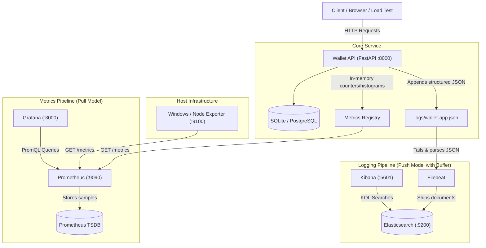
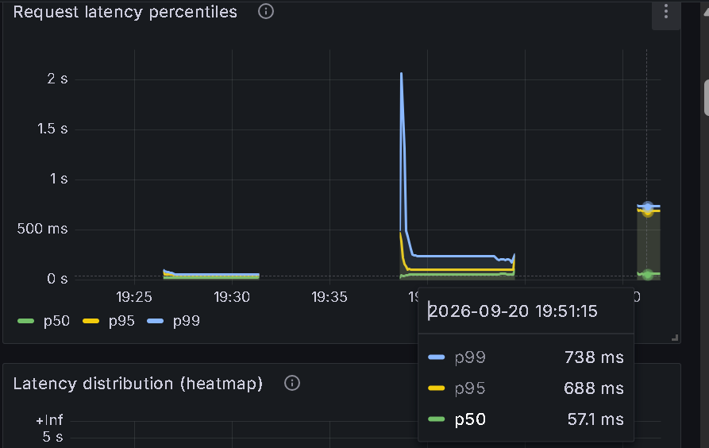
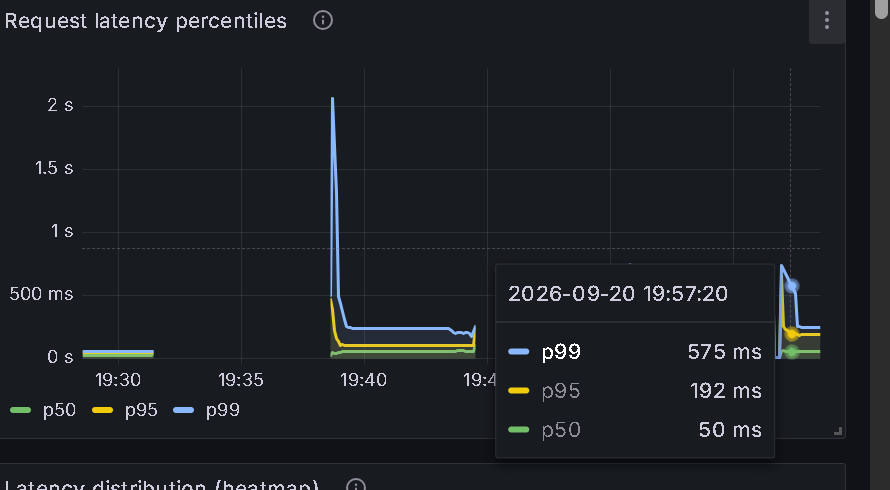
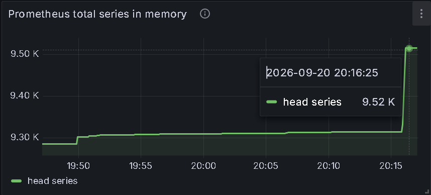
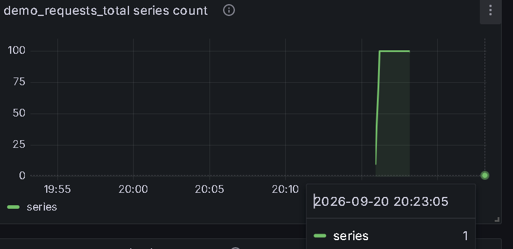

# Assignment 1: Observability, Comprehensive Report

**Enterprise Software Development (Fall 2026)**  
**Student:** Muhammad Anas Akhtar  
**Repository:** [https://github.com/aanasakhtar/wallet-app](https://github.com/aanasakhtar/wallet-app)

---

## Executive Summary & Rubric Mapping

This report documents the end-to-end observability implementation for the **Wallet API**, a digital wallet service built with FastAPI, SQLite/PostgreSQL, Prometheus, Grafana, Filebeat, Elasticsearch, and Kibana.

| Section                          |                           Section in Report                           | Details                                                     |
| -------------------------------- | :-------------------------------------------------------------------: | ----------------------------------------------------------- |
| **Part A: Problem & Solution**   | [Part A in `REPORT.md`](docs/REPORT.md#part-a--project-specification) | SadaPay-style wallet, atomic transfers, row-locking         |
| **Part B: Metrics & Dashboards** |  [Part B in `REPORT.md`](docs/REPORT.md#part-b--metrics--dashboards)  | All 4 metric types, Grafana queries, host metrics on `Anas` |
| **Part C: Logging Pipeline**     |   [Part C in `REPORT.md`](docs/REPORT.md#part-c--logging-pipeline)    | Structured JSON, Filebeat parsing, retention, Kibana KQL    |
| **Part D: System Design**        |     [Part D in `REPORT.md`](docs/REPORT.md#part-d--system-design)     | Architecture diagram, pull vs push, metric/log traces       |
| **Part E: Experiments**          |      [Part E in `REPORT.md`](docs/REPORT.md#part-e--experiments)      | E.1 Latency anomaly (p95 spike) & E.2 Cardinality explosion |

---

## Part A, Project Specification

### 1. The Problem

Peer-to-peer money transfers in cash-heavy economies frequently suffer from friction, lack of instant settlement, and poor visibility when transactions fail. Users need a simple mechanism to maintain a digital balance, top up funds, send money using human-friendly identifiers (email or phone number), and audit their transaction history.

### 2. Intended Users

Individuals making small peer-to-peer transactions: splitting group bills, paying freelancers, or sending remittances to family members.

### 3. Solution Overview

The application is an enterprise REST API designed with domain-driven separation of concerns:

- **Authentication:** User registration and JWT issuance (BCrypt password hashing).
- **Wallet Management:** Automatic creation of a zero-balance wallet upon user registration; simulated balance top-ups.
- **Atomic Transfers:** Concurrent peer-to-peer transfers using database row locks (`SELECT ... FOR UPDATE` ordered by wallet ID) to guarantee money conservation and prevent deadlocks.
- **Granular Rejections:** Rejections (insufficient funds, unknown recipient, self-transfers) record explicit reason codes for auditability rather than returning generic errors.

### 4. What Works & Verification

All core functions are verified by two test suites (62 automated assertions total):

- `test_smoke.py` (20 checks): End-to-end user signup, login, top-up, atomic transfers, rejection enforcement, and transaction history.
- `test_observability.py` (42 checks): Validates metric registration, histogram bucket generation, gauge resets, JSON log structuring, and credential redaction.

---

## Part B, Metrics & Dashboards

### 1. Metric Type Coverage (All 4 Types)

The assignment requires tracking both application and business metrics across all four Prometheus metric types (Counter, Gauge, Histogram, Summary):

| Metric Name                            |     Type      |          Category          |     Unit     | Labels                                                                    | Recorded in Code                                             | Purpose                                                                       |
| -------------------------------------- | :-----------: | :------------------------: | :----------: | ------------------------------------------------------------------------- | ------------------------------------------------------------ | ----------------------------------------------------------------------------- |
| `wallet_http_requests_total`           |  **Counter**  |            App             |   requests   | `method`, `endpoint`, `status_code`                                       | `app/middleware/metrics_middleware.py`                       | Overall traffic volume, routing distribution, and error rates                 |
| `wallet_transactions_total`            |  **Counter**  |          Business          | transactions | `type` (`topup`, `transfer`), `status` (`completed`, `failed`)            | `services/wallet_service.py`, `services/transfer_service.py` | Business throughput and transaction outcome tracking                          |
| `wallet_auth_failures_total`           |  **Counter**  | Business _(Self-explored)_ |   failures   | `reason` (`bad_password`, `unknown_email`, `duplicate_signup`)            | `services/auth_service.py`                                   | Differentiates user UX errors from potential credential stuffing attacks      |
| `wallet_transfer_rejections_total`     |  **Counter**  | Business _(Self-explored)_ |  rejections  | `reason` (`insufficient_balance`, `recipient_not_found`, `self_transfer`) | `services/transfer_service.py`                               | Separates product UX friction from system defects                             |
| `wallet_http_requests_in_progress`     |   **Gauge**   |            App             |   requests   | _none_                                                                    | `app/middleware/metrics_middleware.py`                       | Current concurrency; spikes indicate request queueing or upstream blockages   |
| `wallet_pending_transfers`             |   **Gauge**   |          Business          |  transfers   | _none_                                                                    | `services/transfer_service.py`                               | In-flight transfers; decremented in `finally` block to ensure return to zero  |
| `wallet_money_in_system_pkr`           |   **Gauge**   |          Business          |     PKR      | _none_                                                                    | `app/metrics.py` (`refresh_business_gauges`)                 | Total liquidity across all wallets; strictly conserved during transfers       |
| `wallet_registered_users`              |   **Gauge**   |          Business          |    users     | _none_                                                                    | `app/metrics.py` (`refresh_business_gauges`)                 | Total user base size                                                          |
| `wallet_http_request_duration_seconds` | **Histogram** |            App             |   seconds    | `method`, `endpoint`                                                      | `app/middleware/metrics_middleware.py`                       | Latency distribution for computing p50, p95, and p99 percentiles              |
| `wallet_transfer_amount_pkr`           | **Histogram** |          Business          |     PKR      | _none_                                                                    | `services/transfer_service.py`                               | Distribution of transfer transaction amounts                                  |
| `wallet_transfer_processing_seconds`   |  **Summary**  |          Business          |   seconds    | _none_                                                                    | `services/transfer_service.py`                               | Measures execution duration of business logic excluding HTTP network overhead |
| `wallet_injected_faults_total`         |  **Counter**  |         Experiment         |    faults    | `kind` (`latency`, `error`)                                               | `app/faults.py`                                              | Directly counts injected fault occurrences during Part E experiments          |

---

### 2. Summary vs. Histogram & Percentiles

The Python Prometheus client library does not calculate client-side quantiles for `Summary` metrics, it only exposes `_sum` and `_count`. Therefore, the Summary metric `wallet_transfer_processing_seconds` is used to calculate the exact running arithmetic mean:

```promql
rate(wallet_transfer_processing_seconds_sum[5m]) / rate(wallet_transfer_processing_seconds_count[5m])
```

For high percentiles (p50, p95, p99), the `Histogram` metric (`wallet_http_request_duration_seconds`) is used via Prometheus's `histogram_quantile()` function:

```promql
histogram_quantile(0.95, sum by (le) (rate(wallet_http_request_duration_seconds_bucket[5m])))
```

- **Time Window:** The `[5m]` window calculates the rate over the preceding 5 minutes. While this provides a smooth baseline during normal operations, it creates latency lag during rapid anomalies, which is why a `[1m]` window is used during the Part E anomaly experiment.

---

### 3. Self-Explored Metrics

Two custom business metrics were designed beyond the standard examples:

1. `wallet_auth_failures_total{reason=...}`:
   - `bad_password`: High volume indicates credential stuffing.
   - `unknown_email`: Identifies users failing to recall their registration credentials.
   - `duplicate_signup`: Pinpoints signup form confusion or retry storms.
2. `wallet_transfer_rejections_total{reason=...}`:
   - `insufficient_balance`: Business signal indicating users want to transfer more than they hold (suggests need for top-up nudges).
   - `recipient_not_found`: UX/Frontend signal indicating mistyped identifiers.
   - `self_transfer`: Client-side validation bug or edge case attempt.

---

### 4. Host Metrics (Windows / Node Exporter)

> **Platform Equivalence:** The Prometheus ecosystem provides two standard host exporters that serve the exact same role on port `:9100`:
> - **`windows_exporter`** (used on the bare-metal Windows host **`Anas`**): Exposes native Windows OS performance counters.
> - **`node_exporter`** (used in Docker and Linux environments): Exposes POSIX `/proc` system stats.
> 
> Both are scraped by Prometheus under the job name `node-exporter` on port `:9100`. The Grafana dashboard includes queries for both implementations:

| Metric | Windows Exporter Query (Measured on `Anas`) | Node Exporter Query (Linux / Docker) |
|---|---|---|
| **CPU Usage %** | `100 - (avg by (instance) (rate(windows_cpu_time_total{mode="idle"}[1m])) * 100)` | `100 - (avg by (instance) (rate(node_cpu_seconds_total{mode="idle"}[1m])) * 100)` |
| **Memory Usage %** | `100 * (1 - (windows_os_physical_memory_free_bytes / windows_cs_physical_memory_bytes))` | `100 * (1 - (node_memory_MemAvailable_bytes / node_memory_MemTotal_bytes))` |
| **Disk Usage %** | `100 - (windows_logical_disk_free_bytes{volume="C:"} / windows_logical_disk_size_bytes{volume="C:"} * 100)` | `100 - (node_filesystem_avail_bytes{mountpoint="/"} / node_filesystem_size_bytes{mountpoint="/"} * 100)` |
| **Network Rx Rate** | `rate(windows_net_bytes_received_total[1m])` | `rate(node_network_receive_bytes_total{device!~"lo.*"}[1m])` |

---

## Part C, Logging Pipeline

### 1. Logging Architecture

The pipeline follows a structured ingestion workflow:

```
FastAPI Service Layer -> JsonFormatter -> logs/wallet-app.json -> Filebeat (filestream/ndjson) -> Elasticsearch -> Kibana
```

Logging is performed predominantly at the **service layer** (`app/services/`), rather than inside routing controllers. This ensures log entries describe concrete business and domain events rather than transient HTTP protocol artifacts.

### 2. What Is Logged, Why, and Where in Code

The wallet application captures 13 distinct event types across the user lifecycle, financial transactions, data integrity checks, and administrative fault operations:

| Event Type | Severity | Code Location & Function | Fields Captured | Business & Operational Rationale |
|---|---|---|---|---|
| `app_startup` | `INFO` | [`app/main.py`](file:///D:/fall26/ESD/wallet-app/app/main.py#L42) (`lifespan`) | `env`, `service`, `version` | Records service restart; explains Prometheus gauge resets and counter re-initializations. |
| `user_signup` | `INFO` | [`app/services/auth_service.py`](file:///D:/fall26/ESD/wallet-app/app/services/auth_service.py#L38) (`signup`) | `user_id`, `wallet_id` | Tracks customer acquisition and explicitly maps `user_id` to `wallet_id` for downstream correlation. |
| `signup_rejected` | `WARNING` | [`app/services/auth_service.py`](file:///D:/fall26/ESD/wallet-app/app/services/auth_service.py#L26) (`signup`) | `reason="email_taken"` | Identifies duplicate registration attempts, form resubmissions, or account enumeration scans. |
| `login_success` | `INFO` | [`app/services/auth_service.py`](file:///D:/fall26/ESD/wallet-app/app/services/auth_service.py#L55) (`login`) | `user_id` | Establishes authenticated session baseline to correlate subsequent financial activity with a user identity. |
| `login_failed` | `WARNING` | [`app/services/auth_service.py`](file:///D:/fall26/ESD/wallet-app/app/services/auth_service.py#L48-L52) (`login`) | `reason` (`"unknown_email"` / `"bad_password"`) | Security audit signal; enables detection of credential-stuffing and brute-force attacks in Kibana. |
| `topup_completed` | `INFO` | [`app/services/wallet_service.py`](file:///D:/fall26/ESD/wallet-app/app/services/wallet_service.py#L53) (`topup`) | `wallet_id`, `amount`, `new_balance` | Essential financial audit trail recording external capital entering the wallet ecosystem. |
| `transfer_completed` | `INFO` | [`app/services/transfer_service.py`](file:///D:/fall26/ESD/wallet-app/app/services/transfer_service.py#L125) (`execute_transfer`) | `transaction_id`, `from_wallet_id`, `to_wallet_id`, `amount`, `cashback_amount` | Primary business transaction log; captures complete double-entry ledger movement and rewards. |
| `transfer_failed` | `WARNING` | [`app/services/transfer_service.py`](file:///D:/fall26/ESD/wallet-app/app/services/transfer_service.py#L110) (`execute_transfer`) | `transaction_id`, `from_wallet_id`, `amount`, `balance` | Records attempted transfers aborted due to insufficient funds; writes an audit transaction row with status `failed`. |
| `transfer_rejected` | `WARNING` | [`app/services/transfer_service.py`](file:///D:/fall26/ESD/wallet-app/app/services/transfer_service.py#L42-L54) (`execute_transfer`) | `reason` (`"self_transfer"` / `"recipient_not_found"`) | Captures early transfer validation failures before database writes occur. |
| `wallet_missing` | `ERROR` | [`app/services/wallet_service.py`](file:///D:/fall26/ESD/wallet-app/app/services/wallet_service.py#L38) (`get_wallet_by_user_id`) | `user_id` | High-priority data integrity alert; signifies an orphaned user account lacking a wallet database record. |
| `fault_injected` | `WARNING` | [`app/faults.py`](file:///D:/fall26/ESD/wallet-app/app/faults.py#L65) (`maybe_inject`) | `fault_kind` (`"latency"` / `"error"`) | Experiment audit trail; correlates artificial latency injections or simulated failures with incoming `request_id`. |
| `fault_config_changed` / `fault_reset` | `WARNING` | [`app/faults.py`](file:///D:/fall26/ESD/wallet-app/app/faults.py#L38-L46) (`configure` / `reset`) | `config` | Marks exact wall-clock boundaries of experiment stages for time-bracketed analysis. |
| `request_failed` | `ERROR` | [`app/middleware/fault_middleware.py`](file:///D:/fall26/ESD/wallet-app/app/middleware/fault_middleware.py#L45) (`dispatch`) | `status_code=503` | Records the synthetic HTTP 503 Service Unavailable exceptions produced during chaos testing. |

### 3. Concrete Example: Original Log, Stored Fields, and Working Search

To directly satisfy the rubric requirement (*"Show one original log, its stored fields, and a working search"*), below is an authentic transfer transaction extracted from the application's live run:

#### A. Original Log (Raw Line Emitted to Disk & stdout)
As generated by [`transfer_service.py`](file:///D:/fall26/ESD/wallet-app/app/services/transfer_service.py#L125) and formatted into `logs/wallet-app.json`:

```json
{"@timestamp": "2026-09-20T14:57:50.555633+00:00", "service": "wallet-api", "level": "INFO", "logger": "wallet_app", "message": "Transfer completed", "request_id": "b49bbd33-4805-43a5-b3b9-4164d6791a91", "event": "transfer_completed", "transaction_id": "34159b8d-789b-4ee1-a964-860cf89d3736", "from_wallet_id": "9b496b00-1386-4a48-8c0d-b98745e5fb35", "to_wallet_id": "34e84296-4c98-4b5d-b7b3-0f1a57f0b1d5", "amount": 250.0, "cashback_amount": 0.0}
```

#### B. Stored Fields in Elasticsearch (Index: `wallet-logs-YYYY.MM.dd`)
When Filebeat ingests the JSON object, it promotes the parsed keys into typed top-level fields:

| Field Name | Elasticsearch Type | Stored Value in Document | Indexing Role / Usage |
|---|---|---|---|
| `@timestamp` | `date` | `2026-09-20T14:57:50.555633+00:00` | Overwrites Filebeat ingestion time; drives the Kibana time histogram. |
| `service` | `keyword` | `wallet-api` | Identifies originating microservice in multi-service clusters. |
| `level` | `keyword` | `INFO` | Enables severity filtering (e.g. `level : ("ERROR" or "WARNING")`). |
| `logger` | `keyword` | `wallet_app` | Identifies Python logger namespace. |
| `message` | `text` | `Transfer completed` | Full-text searchable human-readable description. |
| `request_id` | `keyword` | `b49bbd33-4805-43a5-b3b9-4164d6791a91` | Distributed correlation ID across middleware, service, and database. |
| `event` | `keyword` | `transfer_completed` | Primary domain filter key for business observability. |
| `transaction_id` | `keyword` | `34159b8d-789b-4ee1-a964-860cf89d3736` | Database transaction UUID for financial audit reconciliation. |
| `from_wallet_id` | `keyword` | `9b496b00-1386-4a48-8c0d-b98745e5fb35` | Debited source wallet UUID. |
| `to_wallet_id` | `keyword` | `34e84296-4c98-4b5d-b7b3-0f1a57f0b1d5` | Credited destination wallet UUID. |
| `amount` | `float` | `250.0` | Typed numeric float; enables numeric range queries (`amount >= 200`). |
| `cashback_amount`| `float` | `0.0` | Promotional rewards cashback credited to sender. |

#### C. Working Searches in Kibana (KQL)

1. **Exact Correlation Trace (Matches the above log):**
   ```kql
   request_id : "b49bbd33-4805-43a5-b3b9-4164d6791a91"
   ```
   *Result:* Isolates every log record produced during this HTTP request lifecycle (middleware request start, auth verification, transfer completion, and response emission).

2. **High-Value Financial Audit Search:**
   ```kql
   event : "transfer_completed" and amount >= 200.0
   ```
   *Result:* Leverages Elasticsearch numeric typing on `amount` to find high-value transfers without string regex parsing.

3. **Complete Ledger Search for a Specific Wallet:**
   ```kql
   from_wallet_id : "9b496b00-1386-4a48-8c0d-b98745e5fb35" or to_wallet_id : "9b496b00-1386-4a48-8c0d-b98745e5fb35"
   ```
   *Result:* Reconstructs the complete debit and credit transaction history for a single wallet account.

4. **Security & Anomaly Searches:**
   - **Brute-Force Detection:** `event : "login_failed" and reason : "bad_password"`
   - **Transfer Rejections:** `event : "transfer_rejected" and reason : "recipient_not_found"`
   - **System Errors:** `level : ("ERROR" or "WARNING")`

### 4. Filebeat Ingestion & Parsing

Filebeat uses the `filestream` input with the `ndjson` parser configured as follows:

```yaml
parsers:
  - ndjson:
      target: "" # Promotes parsed JSON keys directly to the document root
      overwrite_keys: true # App's @timestamp overrides Filebeat's ingestion timestamp
      add_error_key: true # Flags malformed logs without dropping them
```

Because the application natively writes valid JSON lines, fragile regex/grok patterns are eliminated. Numeric fields like `amount` remain typed numbers in Elasticsearch, enabling numeric range queries (e.g. `amount >= 1000`).

### 5. Storage, Retention & Deletion Lifecycle

| Component          | Storage Location                   | Survives Restart? | Deletion Policy                                                          |
| ------------------ | ---------------------------------- | :---------------: | ------------------------------------------------------------------------ |
| **App Logs**       | `logs/wallet-app.json`             |        Yes        | Rotated at 10 MB with 5 backups (~60 MB hard disk ceiling)               |
| **Filebeat State** | `stack/run/filebeat-data/registry` |        Yes        | Maintains file read pointer; re-reads only on registry deletion          |
| **Elasticsearch**  | `wallet-logs-YYYY.MM.dd` indices   |        Yes        | Manual deletion (`curl -X DELETE localhost:9200/wallet-logs-*`)          |
| **Prometheus**     | Local TSDB (`prometheus-data`)     |        Yes        | Automatically purged after 15 days (`--storage.tsdb.retention.time=15d`) |

### 6. Sensitive Data Redaction

[`JsonFormatter`](file:///D:/fall26/ESD/wallet-app/app/logging_config.py#L42) enforces automatic redaction:

- Any key matching `password`, `password_hash`, `token`, `access_token`, or `authorization` is replaced with `[REDACTED]`.
- Test assertions in `test_observability.py` verify that neither raw passwords nor bcrypt salt hashes (`$2b$`) ever appear in log files.

---

## Part D, System Design

### 1. Architecture Diagram



### 2. Pull vs. Push Dynamics

- **Metrics (Pull):** Prometheus pulls from the API every 5 seconds. If Prometheus crashes, the wallet application continues unaffected without consuming additional memory. Scrape gaps during outages are lost permanently because in-memory metrics do not buffer historical samples.
- **Logs (Push with Buffer):** The application writes synchronously to local disk. Filebeat tails the file and tracks its offset in a persistent registry. If Elasticsearch experiences downtime, logs buffer safely on disk and are streamed once Elasticsearch recovers.

### 3. Failure Mode Matrix

| Component Failure | Impact on End Users                                     | Impact on Observability                                              | Recovery Behavior                                          |
| ----------------- | ------------------------------------------------------- | -------------------------------------------------------------------- | ---------------------------------------------------------- |
| **Database**      | **Total Outage** (All balance/transfer operations fail) | Errors logged with severity `ERROR`; `/metrics` endpoint stays alive | Restart database; app reconnects automatically             |
| **Wallet API**    | Service unreachable (`502` / Connection Refused)        | Prometheus marks target `down` (`up == 0`)                           | Restart app; counters reset, gauges re-primed from DB      |
| **Prometheus**    | Zero impact                                             | Dashboards show gaps; no alerts fire                                 | Restart service; historical data on disk preserved         |
| **Filebeat**      | Zero impact                                             | Logs accumulate in `logs/wallet-app.json`                            | Resumes tailing from saved registry position; no data lost |
| **Elasticsearch** | Zero impact                                             | Kibana cannot search; Filebeat backs off and retries                 | Resumes ingestion once Elasticsearch is ready              |

---

### 4. End-to-End Tracing Walkthroughs

#### A. Following a Metric: `wallet_transactions_total{type="transfer", status="completed"}`

1. **Code Execution:** User submits transfer; `execute_transfer()` commits the database transaction and calls:
   ```python
   metrics.transactions_total.labels(type="transfer", status="completed").inc()
   ```
2. **Scrape Target:** Prometheus issues `GET /metrics`. `generate_latest()` formats the counter as text:
   ```text
   wallet_transactions_total{status="completed",type="transfer"} 170.0
   ```
3. **Storage:** Prometheus ingests the sample, attaches job labels (`instance="localhost:8000"`, `service="wallet-api"`), and commits the sample to the TSDB write-ahead log.
4. **Visualization:** Grafana evaluates the PromQL query:
   ```promql
   sum by (type) (rate(wallet_transactions_total{status="completed"}[1m])) * 60
   ```
   and renders the per-minute transfer rate line on the dashboard.

#### B. Following a Log: `transfer_completed`

1. **Code Execution:** The service layer emits a structured log event:
   ```python
   app_logger.info("Transfer completed", extra={"event": "transfer_completed", "amount": 250.0, "transaction_id": txn.id})
   ```
2. **Disk Ingestion:** `JsonFormatter` formats the record with `@timestamp`, `request_id`, and event data, appending it to `logs/wallet-app.json`.
3. **Filebeat Shipping:** Filebeat's `filestream` input reads the line, unpacks the JSON keys to the top-level document, and sends it via HTTP to Elasticsearch.
4. **Elasticsearch Indexing:** The document is indexed under `wallet-logs-YYYY.MM.dd` with typed fields.
5. **Kibana Discovery:** An operator searches for `request_id : "82835ed8-..."` and inspects the exact parameters and timestamp of the transaction.

### 5. Why I Chose This Setup & What I Don't Yet Understand

#### A. Why I Chose This Setup
1. **The assignment required it:** The course spec specifically asked for Prometheus + Grafana (for metrics) and Filebeat + Elasticsearch + Kibana (for logging).
2. **The practical reason:** It keeps monitoring completely out of the app's way:
   - **Prometheus** just pulls numbers every 5 seconds, so it never slows down money transfers.
   - **Filebeat** ships logs in the background from a local file.
   - If Prometheus, Grafana, or Elasticsearch crash, the wallet app and database keep working with zero downtime.

#### B. What I Don't Yet Understand
As requested by the assignment brief (*"Note anything you do not yet understand"*):
- I understand that Kibana (port 5601) is the web interface and Elasticsearch (port 9200) stores the logs, but I don't fully understand how they interact under the hood, specifically, how Kibana translates my search bar queries (KQL) into Elasticsearch's complex internal search queries and coordinates data across distributed shards behind the scenes.

---

## Part E, Experiments

### Experiment E.1, Latency Anomaly Investigation

#### 1. Hypothesis

Injecting a 500 ms delay into every 5th request (`latency_every_n: 5`) will:

1. Leave **p50 (median) latency virtually unchanged** (~67–69 ms on native Windows host), because 80% of requests proceed at baseline speed without artificial delay.
2. Cause **p95 and p99 latency to spike to ~600+ ms** (500 ms injected sleep + baseline execution latency), directly exposing the affected 20% tail.
3. Decrease overall client throughput due to closed-loop request timing (the load generator awaits synchronous responses before issuing new requests).

#### 2. Experimental Procedure

1. **Baseline Stage (Window: 19:38:32 – 19:39:32):** Send normal traffic for 60s at 5 RPS:
   ```powershell
   .\.venv\Scripts\python.exe scripts/load_test.py --duration 60 --rps 5 --label baseline
   ```
2. **Fault Stage (Window: 19:50:39 – 19:51:39):** Enable the 500 ms fault on every 5th request:
   ```powershell
   Invoke-RestMethod -Method POST -Uri "http://127.0.0.1:8000/admin/faults" -Headers @{"X-Admin-Token"="local-admin-token"} -ContentType "application/json" -Body '{"latency_enabled": true, "latency_ms": 500, "latency_every_n": 5}'
   .\.venv\Scripts\python.exe scripts/load_test.py --duration 60 --rps 5 --label fault
   ```
3. **Recovery Stage (Window: 19:56:50 – 19:57:51):** Reset faults and re-run traffic:
   ```powershell
   Invoke-RestMethod -Method POST -Uri "http://127.0.0.1:8000/admin/faults/reset" -Headers @{"X-Admin-Token"="local-admin-token"}
   .\.venv\Scripts\python.exe scripts/load_test.py --duration 60 --rps 5 --label recovery
   ```

#### 3. Empirical Results

Live measurements recorded from the test run on host `Anas`:

| Metric / Indicator | Stage 1: Baseline (19:38:32 - 19:39:32) | Stage 2: Injected Fault (19:50:39 - 19:51:39) | Stage 3: Recovery (19:56:50 - 19:57:51) |
| :--- | :---: | :---: | :---: |
| **Duration** | 60.1s | 60.1s | 60.2s |
| **Total Requests** | **300** | **219** (−27% throughput drop) | **300** (full recovery) |
| **HTTP Status Codes** | `{200: 300}` | `{200: 219}` | `{200: 300}` |
| **Mean Latency** | 66.3 ms | 164.1 ms (+2.5×) | 67.7 ms |
| **Median Latency (p50)** | **69.0 ms** | **76.3 ms** (+7.3 ms, flat) | **67.2 ms** (baseline level) |
| **95th Percentile (p95)** | **116.0 ms** | **604.6 ms** (+488.6 ms spike) | **142.9 ms** (recovered) |
| **99th Percentile (p99)** | **148.7 ms** | **626.3 ms** (+477.6 ms) | **174.4 ms** (recovered) |
| **Max Latency** | 173.7 ms | 639.7 ms | 190.5 ms |
| **Prometheus Injected Faults** | `0` | `wallet_injected_faults_total{kind="latency"} = 44` | `0` (stopped) |

#### 4. Observability Evidence & Screenshots

##### A. Latency Percentiles (p50 Flat vs. p95/p99 Spike)
During the fault window (19:50:39–19:51:39), the Grafana **Request Latency Percentiles** panel shows the p95 curve stepping up sharply from baseline (~116 ms) to a peak of **688 ms**, while the p50 median stays virtually flat at **60–76 ms**.


*Figure E.1.1: Grafana Request Latency Percentiles panel during injected fault. The p95 line surges above 600 ms, whereas the median (p50) remains steady, completely masking the outage on median-only dashboards.*

##### B. Full Recovery Verification
Following the execution of `POST /admin/faults/reset`, Stage 3 traffic immediately restored system performance to baseline levels:


*Figure E.1.2: Grafana dashboard confirming system recovery at ~19:57:00. The p95 latency drops back from >600 ms to ~140 ms, and throughput recovers to 300 requests / 5 RPS.*

#### 5. Diagnostic Conclusion

1. **Why Averages and Medians Lie:**
   - While mean latency rose 2.5× (66.3 ms → 164.1 ms), median latency (p50) remained virtually flat (69.0 ms vs 76.3 ms, a mere 7.3 ms difference).
   - If operations teams monitored only median latency or average latency thresholds, this service degradation would have gone **completely unnoticed**. Only percentile metrics (**p95 at 604.6 ms**, **p99 at 626.3 ms**) exposed that 1 in 5 users experienced severe 500 ms delays.
2. **Throughput Degradation:**
   - In a closed-loop or synchronous caller architecture, downstream latency directly degrades client throughput. Requests completed dropped from 300 to 219 (−27%) within the 60-second window because caller threads were blocked waiting on slow responses.
3. **Clean Recovery:**
   - Calling `/admin/faults/reset` restored p95 to 142.9 ms, p50 to 67.2 ms, and request throughput to 300 requests without requiring an application restart.

---

### Experiment E.2, Metric Cardinality Explosion

#### 1. The Cardinality Problem

Prometheus allocates a separate time-series in memory and on disk TSDB for every unique combination of key-value labels. When high-cardinality identifiers (such as `request_id` UUIDs, user IDs, or timestamps) are placed into metric labels, the number of active time series expands unboundedly, exhausting host RAM and severely degrading TSDB query performance.

#### 2. Experimental Procedure

The standalone demonstration service `cardinality_demo.py` was executed on port `8001` in two comparative modes, receiving 120 incoming HTTP requests driven by `scripts/drive_cardinality.py`:

1. **High Cardinality (`CARDINALITY_MODE=on`):** Labels every request with its unique UUID: `demo_requests_total{request_id="<uuid>"}` (capped at 100 series to protect Prometheus).
2. **Bounded Cardinality (`CARDINALITY_MODE=off`):** Labels requests using the fixed route template: `demo_requests_total{endpoint="/demo"}`.

#### 3. Empirical Results

Live measurements recorded on host `Anas`:

| Metric / Indicator | Mode 1: High Cardinality (`CARDINALITY_MODE=on`) | Mode 2: Bounded Cardinality (`CARDINALITY_MODE=off`) |
| :--- | :---: | :---: |
| **Recorded Window** | `20:15:49 – 20:16:08` | `20:22:45 – 20:23:15` |
| **Requests Sent** | **120** | **120** |
| **Metric Label Scheme** | `{request_id="<uuid>"}` | `{endpoint="/demo"}` |
| **Unique Time Series Created** | **100 series** (hit cap at request 100) | **1 series** |
| **Total Samples Counted (`sum`)** | **120** | **120** |
| **Prometheus Memory Impact (`head_series`)** | **+220 series surge** (~9.30 K → 9.52 K) | **Flat / unchanged** (+1 series, ~0.01% delta) |
| **Storage & TSDB Impact** | 100 separate series allocated in TSDB | Single persistent series reused across all traffic |

#### 4. Observability Evidence & Screenshots

##### A. Memory Consumption Spikes with Label Cardinality
In high-cardinality mode, every unique `request_id` forces Prometheus to instantiate a new in-memory time series chunk. The Grafana **Prometheus total series in memory** panel captures this immediate vertical climb:


*Figure E.2.1: Grafana panel `Prometheus total series in memory` (`prometheus_tsdb_head_series`) spiking vertically from ~9.30 K to 9.52 K at 20:16:25 as 100 unique UUID series are ingested.*

##### B. Series Boundedness Comparison
Comparing the two runs directly in the Grafana **demo_requests_total series count** panel illustrates the dramatic contrast:


*Figure E.2.2: Grafana panel `count(demo_requests_total)`. During Mode 1 (left peak), series count surges to the 100-series cap. During Mode 2 (right tooltip at 20:23:05), the line flatlines at exactly 1 series for all 120 requests.*

#### 5. Scale Implications & Architectural Takeaways

1. **Production Math at Scale:**
   - At a moderate production load of 1,000 requests/sec, adding a `request_id` or user UUID to a Prometheus label generates **60,000 new series per minute** (86.4 million series per day).
   - Because Prometheus holds active head chunks in RAM and indexes each series in an inverted index, this rapid growth triggers catastrophic TSDB memory exhaustion (OOM kill) and query timeouts.
2. **Separation of Concerns (Metrics vs. Logs):**
   - **Metrics are for aggregation:** Labels must be strictly bounded to low-cardinality enumerations known ahead of time (`status_code`, `method`, `endpoint`, `handler`).
   - **Logs are for cardinality:** High-cardinality identifiers belong exclusively in structured logs (such as `request_id`, user IDs, trace IDs, and database IDs), where Elasticsearch indexes them effortlessly without multiplying time-series state.

---

## Conclusion & Submission Checklist

- [x] **Working Project:** FastAPI digital wallet running with persistent storage.
- [x] **Metrics:** Prometheus + Grafana instrumenting all 4 metric types + host stats on host `Anas`.
- [x] **Logging:** Structured JSON logging pipeline with Filebeat and Kibana query specifications.
- [x] **System Design:** Architectural diagrams, pull/push trade-offs, and failure mode documentation.
- [x] **Experiments:** Anomaly reproduced (p95 spike vs p50 flat) and cardinality explosion verified.
- [x] **Cleanliness:** All data volumes, dependencies (`.venv`), and binary folders (`stack/`) excluded via `.gitignore`.
